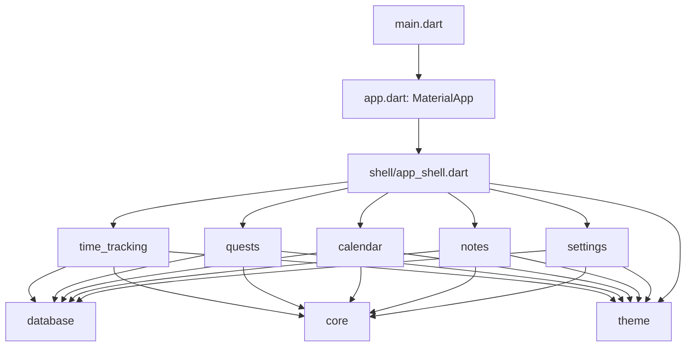
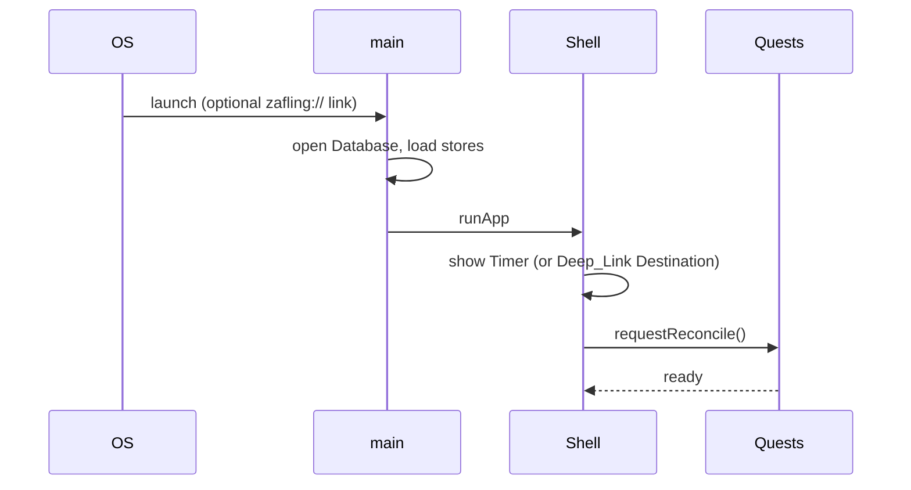

# Design Document: App Foundation

## Overview

The App is created by copying QuestLog 1.5.0 into `/workspace/Zafling`, renaming it, and regrouping its files from layer-first (`data/`, `services/`, `ui/`) to feature-first (`quests/`, `calendar/`, `notes/`). Code is moved, not rewritten: file contents stay the same except for imports, names and the Shell. TimeLog arrives in spec `002-time-tracking-port`.

**Key design decisions:**
- **New project, QuestLog as the base**: QuestLog already uses Riverpod 3, one Drift database, `app_state` settings, l10n with a template ARB and the structure check. TimeLog (Riverpod 2, SharedPreferences, native iOS code) is ported into that frame.
- **Feature-first folders with one isolated feature**: `time_tracking/` is independent and talks to the rest only through `core/`, `database/`, `theme/`, `ui_kit/`. The QuestLog modules (`quests/`, `calendar/`, `notes/`, `settings/`) were one product and depend on each other (the Board shows calendar events, an event awards XP, a Note in the Trash reuses quest actions). Untangling that would change QuestLog, which this spec does not do, so the coupling is allowed inside that group, and the test fences the group off from `time_tracking/` and the Shell. The Shell is the only place that knows every feature, so a new feature is one folder plus one Destination entry.
- **One Database, original table names**: the importer in `003-legacy-import` can copy rows table by table without renaming. Table classes stay in their feature folder; `database/app_database.dart` lists them.
- **One theme, a registry for more**: the blue theme of QuestLog (dark `guildBoard`, light `daylight`) is the only theme, and the Time_Module is restyled to it. `ThemeDefinition` objects in a registry hold the palettes, so a second theme is one more definition. The only restyling in the move is that of the Time_Module screens.
- **Bottom bar for the five main pages, Drawer for the rest**: Timer, Quests, Calendar, Notes and Settings are tabs; the Drawer lists the complete navigation (the five tabs, History, Statistics and Missions), and the bar marks the tab a Drawer-only page belongs to. `IndexedStack` keeps state alive.
- **Own URL scheme**: `zafling://` so the Legacy_Apps keep their schemes while installed. The native handler of the Live Activity takes only `zafling://action/...`; every other `zafling://` link goes to `app_links` through `super`.
- **iOS project from TimeLog**: a widget extension target cannot be created reliably by hand-editing `project.pbxproj`, so the App starts from TimeLog's `ios/` (which has it) and receives QuestLog's URL scheme and `FlutterDeepLinkingEnabled` entries.
- **Menu button in the existing header**: every Destination already has its own header; the Shell supplies a `MenuButton` widget that each screen places in it, so no new bar appears.
- **One export for everything**: the new export writes every table plus the SharedPreferences (format `zafling-export`), because after the move it is the only backup.



## Architecture

Startup: `main` opens the Database, loads stores that must exist before the first frame (the calendar filter store), builds the `ProviderScope` and runs the app. The Shell starts the Reconciliation of the Quest_Module in the background and shows the Timer at once; the splash covers only the Quest destinations until the Reconciliation has finished. Time_Module startup (notifications, reminders, Live Activity) is added in spec 002 through a `TimeTrackingBootstrap` hook called from `main`.



### Destination model

`Destination` is an enum in `shell/destination.dart`. Each value has a deep-link name, an icon, an l10n label, a group, a parent tab and a builder. The Bottom_Bar (`isTab`), the Drawer (`!isTab`), the deep-link parser and the `IndexedStack` all derive from this one enum, so a Destination cannot be in one and missing from another.

## Project Structure

```
Zafling/
├── lib/
│   ├── main.dart                 # entry point: Database, stores, ProviderScope
│   ├── app.dart                  # MaterialApp: locale, theme, overlay
│   ├── core/                     # pure Dart: clock, errors, validation, board day, date helpers
│   ├── database/
│   │   ├── app_database.dart     # @DriftDatabase listing every table; schemaVersion
│   │   ├── app_database.g.dart   # generated, committed
│   │   ├── connection.dart       # opens zafling.sqlite
│   │   └── export/               # database_export.dart, export_service.dart (moved from QuestLog)
│   ├── ui_kit/                   # shared widgets: common/, sheet/, forms/
│   ├── theme/                    # shell_theme.dart, quest_theme.dart, tokens, typography (time palette lives in time_tracking/theme)
│   ├── l10n/                     # app_cs.arb (template), app_en.arb, generated/
│   ├── shell/                    # app_shell.dart, destination.dart, app_drawer.dart, deep_link.dart, splash_screen.dart, reconcile_banner.dart
│   ├── settings/                 # settings_screen.dart + groups, shortcut_guide.dart, settings_service.dart, preferences
│   ├── quests/                   # data/ domain/ services/ ui/ (board, missions, mission_detail, sheets, widgets)
│   ├── calendar/                 # data/ domain/ services/ ui/
│   ├── notes/                    # data/ domain/ services/ ui/ (editor, markdown)
│   └── time_tracking/            # filled by spec 002
├── test/                         # mirrors lib/; goldens/ and helpers/
├── assets/                       # fonts (both apps), icons, audio (spec 002)
├── drift_schemas/
├── scripts/                      # check.sh, check-structure.sh
├── ios/
├── .kiro/specs/
└── CLAUDE.md, README.md, DOCS.md, FEATURES.md, pubspec.yaml
```

Each feature folder has at most the subfolders `data/`, `domain/`, `services/`, `ui/`, so no directory approaches 15 files; `quests/ui/` is split into `board/`, `missions/`, `sheets/`, `widgets/` as in QuestLog.

## Components and Interfaces

### 1. Destination (`lib/shell/destination.dart`)

```dart
enum DestinationGroup { time, planning, notes, app }

enum Destination {
  timer, history, statistics, quests, missions, calendar, notes, settings;

  bool get isTab;               // timer, quests, calendar, notes, settings
  Destination get tab;          // history, statistics -> timer; missions -> quests; a tab -> itself

  String get linkName;                       // 'timer', 'history', ...
  DestinationGroup get group;
  String label(AppLocalizations l);
  IconAsset get icon;
}

/// The Destination a `zafling://<name>` link opens; null for anything else.
Destination? destinationFromUri(Uri uri);
```

### 2. AppShell (`lib/shell/app_shell.dart`)

```dart
class AppShell extends ConsumerStatefulWidget {
  const AppShell({super.key, this.initial = Destination.timer});
}
```

Holds the selected Destination, the Reconciliation state machine moved unchanged from QuestLog, the lifecycle observer and the deep-link subscription. Builds a `Scaffold` with the `AppDrawer`, an `IndexedStack` of all eight Destinations and the `BottomBar`.

### 3. BottomBar and AppDrawer (`lib/shell/bottom_bar.dart`, `lib/shell/app_drawer.dart`)

```dart
/// The five tabs; `selected` is the tab of the shown Destination.
class BottomBar extends StatelessWidget {
  const BottomBar({super.key, required this.selected, required this.onSelect});
  final Destination selected;
  final ValueChanged<Destination> onSelect;
}

/// Lists every Destination: Time (Timer, History, Statistics), Planning (Quests, Missions, Calendar, Notes), then Settings.
class AppDrawer extends StatelessWidget {
  const AppDrawer({super.key, required this.selected, required this.onSelect});
  final Destination selected;
  final ValueChanged<Destination> onSelect;
}
```

### 4. Deep links (`lib/shell/deep_link.dart`)

```dart
final deepLinksProvider = Provider<Stream<Uri>>((ref) => const Stream<Uri>.empty());
Stream<Uri> appLinksStream();
```

Same contract as QuestLog; only the scheme and the Destination set change.

### 5. AppDatabase (`lib/database/app_database.dart`)

```dart
@DriftDatabase(tables: [
  Missions, Quests, RecurringRules, RuleQuests, AppState,
  NoteNodes,
  CalendarEvents, CalendarSkippedDates, CalendarCompletions, CalendarAddresses,
  TimeEntries, RecurringReminders, CompletionRecords, TaskProjects, Tasks,
])
class AppDatabase extends _$AppDatabase {
  AppDatabase() : super(openConnection());
  AppDatabase.forTesting(super.e);
  @override int get schemaVersion => 1;
}
```

The Time_Module tables are added when spec 002 reaches them; until then the list holds the QuestLog tables.

### 6. Theme (`lib/theme/`)

```dart
class ThemeDefinition {
  const ThemeDefinition({required this.id, required this.labelKey, required this.light, required this.dark});
  final String id;
  final AppPalette light;
  final AppPalette dark;
}

const List<ThemeDefinition> themeRegistry = [blueTheme];
final activeThemeIdProvider = Provider<String>((ref) => blueTheme.id);
ThemeData buildTheme({required AppPalette palette});     // as in QuestLog
```

`ZaflingApp`'s `MaterialApp` takes `theme` from the active definition's light palette and `darkTheme` from its dark palette. Screens read `context.palette`.

### 7. MenuButton and ShellMenuScope (`lib/ui_kit/common/menu_button.dart`)

```dart
/// Provided by the Shell above the Destinations; `open` opens the Drawer.
class ShellMenuScope extends InheritedWidget {
  const ShellMenuScope({super.key, required this.open, required super.child});
  final VoidCallback open;
  static ShellMenuScope? maybeOf(BuildContext context);
}

/// Shows nothing when no scope is above it (tests, pushed routes).
class MenuButton extends StatelessWidget {
  const MenuButton({super.key});
}
```

Each Destination header places `MenuButton`. It lives in `ui_kit/` so the QuestLog modules can use it without importing `shell/`. A pushed route is not below the scope, so it shows no button and keeps its back button. A swipe from the screen edge is not used, because it collides with the iOS back swipe and with reorder and slide gestures.

### 8. Settings (`lib/settings/`)

`SettingsService` keeps `language` and `themeMode` in the `app_state` table (QuestLog's mechanism). TimeLog's SharedPreferences keys for language and theme are not read by the App (spec 002 Requirement 8).

## Data Models

Tables are the union of the Legacy_Apps' tables with unchanged names:

| Source | Tables |
|---|---|
| QuestLog (schema 6) | `missions`, `quests`, `recurring_rules`, `rule_quests`, `app_state`, `note_nodes`, `calendar_events`, `calendar_skipped_dates`, `calendar_completions`, `calendar_addresses` |
| TimeLog (schema 8) | `time_entries`, `recurring_reminders`, `completion_records` (the Tasks tables `task_projects` and `tasks` are not carried over and are skipped on import) |

No table name occurs twice. Foreign keys stay inside one feature, except those that already exist in QuestLog between `quests` and `calendar_events`; those two features are therefore allowed to share the table classes through `database/`, not through each other's folders.

## Correctness Properties

### Property 1: Every Destination is reachable

*For any* Destination value, THE Bottom_Bar or the Drawer SHALL list it (a tab in the bar, any other Destination in the Drawer), THE deep-link parser SHALL map `zafling://<linkName>` back to it, and THE Shell SHALL build a screen for it.

**Validates: Requirements 4.2, 4.3, 5.1**

### Property 2: Foreign links are ignored

*For any* URI whose scheme is not `zafling` or whose host is not a Destination link name, THE Shell SHALL leave the selected Destination unchanged.

**Validates: Requirements 5.2, 5.4**

### Property 3: Folder boundaries hold

*For any* source file under `lib/`, THE file SHALL respect the import rules of Requirement 1.4, 1.5 and 1.6.

**Validates: Requirements 1.4, 1.5, 1.6, 1.7**

### Property 4: Table names are unique

*For any* two tables of the Database, THE tables SHALL have different `actualTableName` values.

**Validates: Requirements 2.2, 2.3**

## Error Handling

| Category | Trigger | Behavior |
|---|---|---|
| Database open fails | Corrupt or unreadable `zafling.sqlite` | Show a full-screen error with a retry button; never delete the file |
| Reconciliation fails | Exception in the Quest_Module start | Show the reconcile banner with retry, as QuestLog does; Time_Module keeps working |
| Unknown deep link | Wrong scheme or host | Ignored silently |
| Export fails | Share sheet or file error | Snackbar `settings_exportFailed` |
| Deep link `zafling://action/...` | Live Activity control | Handled natively, never reaches the Shell |
| Missing ARB key | Key in one language only | Test fails |

## Testing Strategy

- **Unit and widget tests** (`flutter_test`): ported from QuestLog, mirrored under `test/`. New tests: Destination, Bottom_Bar, Drawer and deep links, first screen, empty Database tables.
- **Structure test** (`test/architecture/feature_imports_test.dart`): scans `lib/` and fails on a cross-feature import (Property 3).
- **Golden tests**: ported from QuestLog; regenerated only for screens whose Shell chrome changed.
- **Gate**: `scripts/check.sh`. The iOS build and on-device checks are done by Martin; the sandbox has Linux only.
