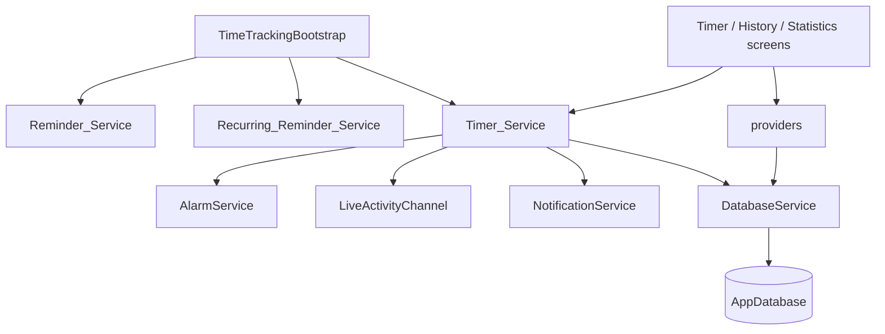

# Design Document: Time Tracking Port

## Overview

The Time_Module is TimeLog's `lib/` regrouped into `lib/time_tracking/` and adapted to the App. Files are moved with the least change possible: imports, the Riverpod 3 legacy API, the removal of the bottom navigation and the shared language and theme. Nothing is redesigned.

**Key design decisions:**
- **Riverpod legacy import**: TimeLog uses `StateNotifierProvider` and `StateProvider`, which Riverpod 3 keeps in `package:flutter_riverpod/legacy.dart`. Importing it keeps behaviour identical; converting to `Notifier` is a later refactor.
- **SharedPreferences stays**: timer state, reminder settings, suggestions and the pending reminder id keep their keys. Rewriting them into the Database would change behaviour and the importer would have to translate them.
- **`TimeTrackingBootstrap`**: the code in TimeLog's `main()` (permission request, reminder initialisation, pending reminder, launch payload, rescheduling) moves into one class called from `main`, so `main.dart` stays small and the Time_Module owns its startup.
- **Navigator key moves to `shell/`**: `navigatorKey` is needed by notification handlers; the Shell owns it and passes a `GlobalKey<NavigatorState>` into the bootstrap, so the Time_Module does not import the Shell.
- **Native code is moved verbatim**: only identifiers change (bundle id, App Group, URL scheme, channel names stay).
- **Tasks not ported**: the screen is unreachable in TimeLog and Martin does not use Tasks, so the screen, `TaskService`, providers, tables and data are all dropped; Project_Suggestions read only the saved names.



## Architecture

Timer lifecycle is unchanged: `idle → running ⇄ paused → ringing → idle`. On start the Timer_Service starts the Live_Activity and schedules the native notification; on pause it updates the activity; on stop or ring it ends them and the description sheet saves the Time_Entry through `DatabaseService`.

Reminder taps arrive through `flutter_local_notifications`. The handler stores the reminder id in SharedPreferences and in `pendingReminderActionProvider`; the Shell's `ReminderActionHost` opens the `ReminderActionScreen` on the next frame or on resume. The Live Activity controls call `daylog://action/...`; `AppDelegate.swift` receives them and forwards to the timer through the existing method channel.

## Project Structure

```
lib/time_tracking/
├── time_tracking.dart               # public API: bootstrap, destinations, settings widgets
├── bootstrap.dart                   # TimeTrackingBootstrap (was TimeLog main())
├── domain/                          # activity_types, config, date_format_utils, active_days_utils, extensions
├── data/                            # tables: time_entry, recurring_reminder, completion_record, task, task_project; stats_data
├── services/                        # timer_service(+freezed), alarm, notification, reminder, recurring_reminder, project, task, database_service
│   └── native/                      # live_activity_channel, platform_channel
├── providers/                       # timer, history, statistics, reminder*, task, suggestions
├── theme/                          # time_theme.dart (adapter from the App palette; was core/theme.dart)
└── ui/
    ├── screens/                     # timer, history, statistics, reminder_action, reminder_settings
    ├── widgets/                     # cards, sheets, controls (split into sheets/, controls/, reminders/ if over 15)
    ├── activity_picker/
    └── painters/                    # bar, ring, timeline
ios/Runner/                          # AppDelegate.swift, LiveActivityManager.swift (from spec 001; identifiers renamed here)
ios/DayLogWidgetExtension/          # Live Activity extension (was TimeLogWidgetExtension)
assets/audio/alarm.mp3
assets/fonts/{Sora,JetBrainsMono}/
```

TimeLog's `ui/widgets/` has 23 files; they are split into `sheets/`, `controls/`, `reminders/` and `cards/` so none exceeds 15.

## Components and Interfaces

### 1. TimeTrackingBootstrap (`lib/time_tracking/bootstrap.dart`)

```dart
class TimeTrackingBootstrap {
  TimeTrackingBootstrap({required this.navigatorKey});
  final GlobalKey<NavigatorState> navigatorKey;

  /// Requests permission, initialises reminders, restores a pending
  /// reminder tap, handles the launch payload once, reschedules reminders.
  Future<ProviderContainer> start(ProviderContainer container);
}
```

### 2. Public API (`lib/time_tracking/time_tracking.dart`)

```dart
class TimerScreen extends ConsumerStatefulWidget {}       // the Timer destination
class HistoryScreen extends ConsumerWidget {}             // the History destination
class StatisticsScreen extends ConsumerWidget {}          // the Statistics destination
class TimeSettingsGroups extends ConsumerWidget {}        // reminders, testing tools
class ReminderActionHost extends ConsumerStatefulWidget {} // opens Reminder_Action_Screen
final timeLocaleProvider = Provider<Locale>(...);         // the app root overrides it with the app language
void refreshStatistics(WidgetRef ref);
```

The Shell imports only this file.

### 3. Timer_Service (`services/timer_service.dart`)

Moved unchanged: `TimerStatus`, `TimerState` (freezed), `TimerNotifier`. Generated `timer_service.freezed.dart` stays committed.

### 4. Time theme adapter (`theme/time_theme.dart`)

```dart
/// The colours TimeLog widgets read, derived from the App palette.
class AppThemeData {
  factory AppThemeData.fromPalette(AppPalette palette, Brightness brightness);
}
final timeThemeProvider = Provider<AppThemeData>((ref) => ...);   // follows the active theme
```

TimeLog widgets keep reading `AppThemeData` fields, so they are not rewritten; the adapter maps each field to a palette role. TimeLog's own palettes (`ember`, `midnight`, `paper`) and the theme selection are removed. The activity colours stay computed by `activityEntryColor(type, subtype, isDark:)`.

### 5. Language and theme providers

`localeProvider` and `themeProvider` of TimeLog are removed; the Time_Module reads `effectiveLocaleProvider` and `themeModeProvider` through two thin provider aliases in `time_tracking/providers/app_settings_bridge.dart`, which the Shell overrides with the Settings values. `loadAppLocalizations()` reads the language from the Database through the bridge.

### 6. Native iOS

The `ios/` folder comes from TimeLog `v1.2.0` in spec `001-app-foundation` (it holds the extension target). This spec renames the remaining identifiers and checks the behaviour:

- Method channels `com.jablecnik.timelog/…` become `com.jablecnik.daylog/…` in `AppDelegate.swift`, `platform_channel.dart`; the Darwin notification `com.jablecnik.timelog.action` becomes `com.jablecnik.daylog.action` in the Runner and in `DayLogIntents.swift`.
- `application(_:open:options:)` handles only `scheme == "daylog"` and `host == "action"`; everything else calls `super`, so `app_links` receives `daylog://timer`, `daylog://quests` and the other Destination links. `FlutterDeepLinkingEnabled` stays on.
- App Group constant `group.com.jablecnik.daylog` in Runner, extension, both entitlements.
- `DayLogWidgetExtension` keeps its four Swift files; `Link` URLs use `daylog://action/<stop|pause|resume>`.
- `alarm.caf`, `alarm.mp3` and `reminder_sound.wav` stay in `ios/Runner/`.

## Data Models

Tables as in TimeLog schema 8 without the Tasks tables (`TimeEntries`, `RecurringReminders`, `CompletionRecords`), added to `AppDatabase` at schema version 1 with `createAll`. The TimeLog migration steps 2–8 are not carried over, because the Database is new; the importer in spec `003` fills the tables from the export.

Time_Preferences keys kept: `reminder_*`, project suggestion lists, timer state keys, `pending_reminder_action_id`, `handled_launch_reminder_id`. Dropped: `app_language`, `selected_theme`.

## Correctness Properties

### Property 1: Timer state survives a restart

*For any* running or paused Timer_Service state persisted to Time_Preferences, restoring it SHALL yield the same status and the same remaining seconds, adjusted by the elapsed wall-clock time while running.

**Validates: Requirements 1.4**

### Property 2: Logical day boundary

*For any* timestamp, THE Time_Module SHALL assign it to the logical day that starts at 03:00, so a timestamp between 00:00 and 02:59 belongs to the previous day.

**Validates: Requirements 3.1**

### Property 3: Untracked time

*For any* period of D days and tracked time T within it, THE Statistics_Screen SHALL show untracked time equal to `16 * 60 * D - T` minutes.

**Validates: Requirements 4.2**

### Property 4: Suggestions include saved names

*For any* project name saved in a category, THE Project_Suggestions of that category SHALL contain the name afterwards, once.

**Validates: Requirements 2.4, 2.5**

### Property 5: Time_Module is isolated

*For any* file under `lib/time_tracking/`, THE file SHALL NOT import `lib/quests/`, `lib/calendar/`, `lib/notes/` or `lib/settings/`.

**Validates: Requirements 1.6, 9.4**

## Error Handling

| Category | Trigger | Behavior |
|---|---|---|
| Live Activity unavailable | Disabled, unsupported, Linux | `startLiveActivity` returns false; no error shown |
| Platform channel missing | Tests, Linux | Wrapped in try/catch; call is a no-op |
| Notification permission denied | User declined | Settings shows the state; timer works without notifications |
| `getNotificationAppLaunchDetails` throws | Linux | Caught inside `getLaunchPayload()` |
| Invalid manual entry times | End before start | Validation message, entry not saved |
| Database write fails | Disk or lock error | Snackbar with the error; the timer state stays so the entry is not lost |

## Testing Strategy

- **Ported tests** (`flutter_test`): all TimeLog tests under `test/` mirrored into `test/time_tracking/`; property tests keep their form and tags.
- **New tests**: bootstrap launch payload handled once; Time_Module import isolation (extends `test/architecture/feature_imports_test.dart`); the language bridge.
- **Equivalence check**: a script-free manual diff of each moved file against the TimeLog tag `v1.2.0` (`git -C /workspace/TimeLog diff --no-index`), summarised in the checkpoint report.
- **Not testable here**: Live Activity, native notifications and the alarm on a device; Martin checks them on the iPhone.
