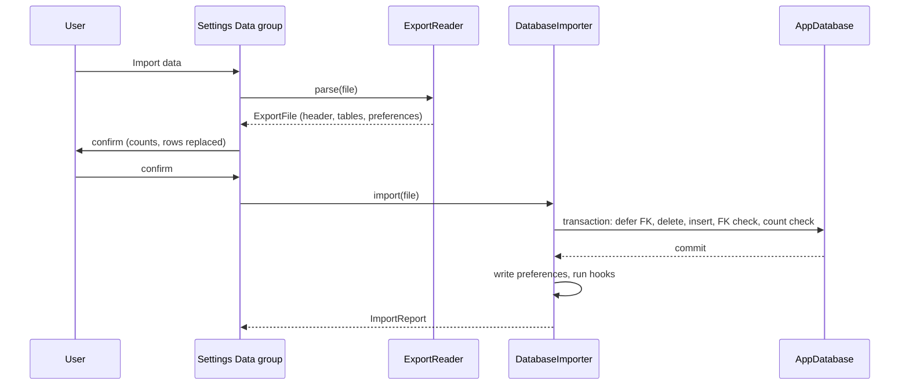

# Design Document: Legacy Import

## Overview

The Importer is the inverse of the export code added to QuestLog 1.5.0 and TimeLog 1.2.0. It is schema-independent in the same way: it walks `tables` of the file and writes each table through Drift's `customStatement`, validating names against `db.allTables` so nothing is built from an untrusted string.

**Key design decisions:**
- **Replace, not merge**: the file wins for every table it contains. A merge would need conflict rules for rows and keys; replacing is simple, predictable and idempotent (Requirement 3.7).
- **One transaction, verified before commit**: any mismatch rolls the whole import back, so there is never a half-imported Database.
- **Validate names against the Database**: table and column names come from the file; they are matched against `db.allTables` and each table's columns, then quoted. Values are always bound parameters.
- **Preferences after the commit**: SharedPreferences has no transaction. Writing it last means a failure leaves the Database complete and reports the gap, instead of leaving preferences without data.
- **Pure core, thin shell**: `ExportReader` (parse and validate) and `ImportPlan` are pure Dart and unit tested; `DatabaseImporter` does the I/O.
- **Removable**: lives in `lib/database/import/` plus one Settings row; no feature depends on it.



## Architecture

`DatabaseImporter.import` runs: (1) build an `ImportPlan` from the file and the Database schema; (2) `transaction`: `PRAGMA defer_foreign_keys = ON`, delete rows of each planned table, insert rows in batches, `PRAGMA foreign_key_check`, count each table; (3) after commit write preferences; (4) call the hooks. Any exception inside (2) rolls back.

For `calendar_events` the delete removes the rows seeded by `onCreate` of the new Database. The QuestLog file holds QuestLog's own seeded rows (and omits a holiday the user deleted there), so the result equals the QuestLog state. Seeding runs only in `onCreate`, so it does not run again after the import.

## Project Structure

```
lib/database/import/
├── export_file.dart          # ExportFile, ExportHeader, parse + validation (pure)
├── import_plan.dart          # ImportPlan: tables, columns, order (pure)
├── database_importer.dart    # transaction, counts, report
├── preferences_writer.dart   # typed SharedPreferences write, key filter
└── import_report.dart        # ImportReport, TableResult, ImportFailure
lib/settings/data/
├── import_row.dart           # picker, confirmation dialog, report view
└── import_hooks.dart         # wires reschedule + reconcile from the Shell
test/database/import/         # mirrors the above + fixtures/
```

## Components and Interfaces

### 1. ExportFile (`lib/database/import/export_file.dart`)

```dart
class ExportHeader {
  final String format;          // 'questlog-export' | 'timelog-export'
  final int formatVersion;
  final String app;
  final String appVersion;
  final int schemaVersion;
  final DateTime exportedAt;
  final Map<String, int> rowCounts;
}

class ExportFile {
  final ExportHeader header;
  final Map<String, List<Map<String, Object?>>> tables;
  final Map<String, Object?> preferences;     // empty for questlog-export
  static ExportFile parse(String json);       // throws ImportFailure
}
```

### 2. ImportPlan (`lib/database/import/import_plan.dart`)

```dart
class ImportPlan {
  factory ImportPlan.build(ExportFile file, GeneratedDatabase db);   // throws ImportFailure for unknown table/column
  final List<PlannedTable> tables;     // name, columns, rows
  int deletedRowCount(Map<String, int> existing);

  /// Columns an old export holds and the Database no longer has; skipped, not refused.
  static const Map<String, Set<String>> retiredColumns = {'app_state': {'display_font'}};
}
```

### 3. DatabaseImporter (`lib/database/import/database_importer.dart`)

```dart
class ImportHooks {
  final Future<void> Function(Map<String, Object?> preferences) writePreferences;
  final Future<void> Function() afterImport;   // reschedule reminders, reconcile quests
}

class DatabaseImporter {
  DatabaseImporter(this._db, this._hooks);
  Future<Map<String, int>> currentCounts(ExportFile file);   // rows now in the tables to be replaced
  Future<ImportReport> import(ExportFile file);              // throws ImportFailure after rollback
}
```

### 4. Preferences writer (`lib/database/import/preferences_writer.dart`)

```dart
const ignoredPreferenceKeys = {
  'app_language', 'selected_theme',
  'pending_reminder_action_id', 'handled_launch_reminder_id',
};
Future<void> writePreferences(SharedPreferences prefs, Map<String, Object?> values);
```

Types map from JSON: string → `setString`, integer → `setInt`, number with fraction → `setDouble`, bool → `setBool`, list of strings → `setStringList`.

### 5. Report and failure (`lib/database/import/import_report.dart`)

```dart
class TableResult { final String table; final int read; final int written; final int expected; }
class ImportReport { final String sourceApp; final List<TableResult> tables; final bool preferencesWritten; }
class ImportFailure implements Exception { final ImportFailureKind kind; final String detail; }
enum ImportFailureKind { notJson, wrongFormat, newerFormat, missingSection, unknownTable,
                         unknownColumn, foreignKey, countMismatch, preferences }
```

### 6. Settings row (`lib/settings/data/import_row.dart`)

A row in the Data group below Export. Uses `file_picker` for `.json` files, the confirmation dialog of Requirement 2 and a report sheet after success. Busy guard like `ExportRow`.

## Data Models

The Export_File layout (from the export code):

```json
{
  "format": "questlog-export", "formatVersion": 1, "app": "questlog",
  "appVersion": "1.5.0", "schemaVersion": 6, "exportedAt": "2026-11-20T10:00:00.000",
  "rowCounts": { "quests": 12 },
  "tables": { "quests": [ { "id": 1, "title": "…", "payload": { "$blob": "AAEC" } } ] },
  "preferences": { "reminder_enabled": true }
}
```

`preferences` exists in `timelog-export` and `zafling-export`. Values keep SQLite types: dates are integers or text exactly as stored.

## Correctness Properties

### Property 1: Round trip

*For any* Database content produced by the Legacy_App export code, importing its Export_File into an empty Database of the App SHALL make every imported table equal, row by row, to the source table.

**Validates: Requirements 3.1, 3.2, 3.3, 9.1**

### Property 2: Idempotence

*For any* valid Export_File, importing it twice SHALL leave the Database in the same state as importing it once.

**Validates: Requirements 3.7**

### Property 3: Atomicity

*For any* Export_File that fails validation, the foreign key check or the count check, THE Database SHALL equal its state before the import started.

**Validates: Requirements 1.3, 1.4, 1.5, 1.6, 3.5, 4.2**

### Property 4: Blob fidelity

*For any* byte sequence, encoding it as `{"$blob": base64}` and importing it SHALL produce a BLOB with the same bytes.

**Validates: Requirements 3.3**

### Property 5: Counts match

*For any* successful import, the number of rows in each imported table SHALL equal its Row_Counts entry.

**Validates: Requirements 4.1, 4.3**

### Property 6: Ignored preferences

*For any* Time_Preferences map, THE Importer SHALL write every key except those in `ignoredPreferenceKeys`.

**Validates: Requirements 6.2, 6.3, 6.5**

## Error Handling

| Category | Trigger | Behavior |
|---|---|---|
| `notJson`, `missingSection` | Bad file | Refuse, message names the problem, nothing changed |
| `wrongFormat`, `newerFormat` | Unknown `format` or version | Refuse, nothing changed |
| `unknownTable`, `unknownColumn` | File does not match the Database | Refuse, name the table or column |
| `foreignKey` | Violation at the FK check | Roll back, name the table |
| `countMismatch` | Rows written ≠ expected | Roll back, show expected and actual |
| `preferences` | SharedPreferences write fails | Database stays imported, report shows the gap |
| Picker cancelled | User cancels | Nothing happens |

All messages are Czech and English through `AppLocalizations` keys prefixed `import_`.

## Testing Strategy

- **Unit tests** (`flutter_test`): `ExportFile.parse` per refusal, `ImportPlan` per unknown name, `writePreferences` per type and ignored key.
- **Property tests**: Properties 1–6 with generated rows (`dart:math` seeded generator, 100 cases) against `AppDatabase.forTesting(NativeDatabase.memory())`.
- **Fixtures**: `test/database/import/fixtures/` hold export files produced by running the Legacy_Apps' own export functions on a populated test database (QuestLog and TimeLog repositories at the frozen tags); generated once and committed.
- **Real data**: a test marked `@Tags(['real-data'])` reads `/workspace/Zafling/.import/*.json` (gitignored) when present and is skipped otherwise.
- **Not testable here**: the iOS file picker and share-sheet transfer; Martin checks them on the iPhone.
