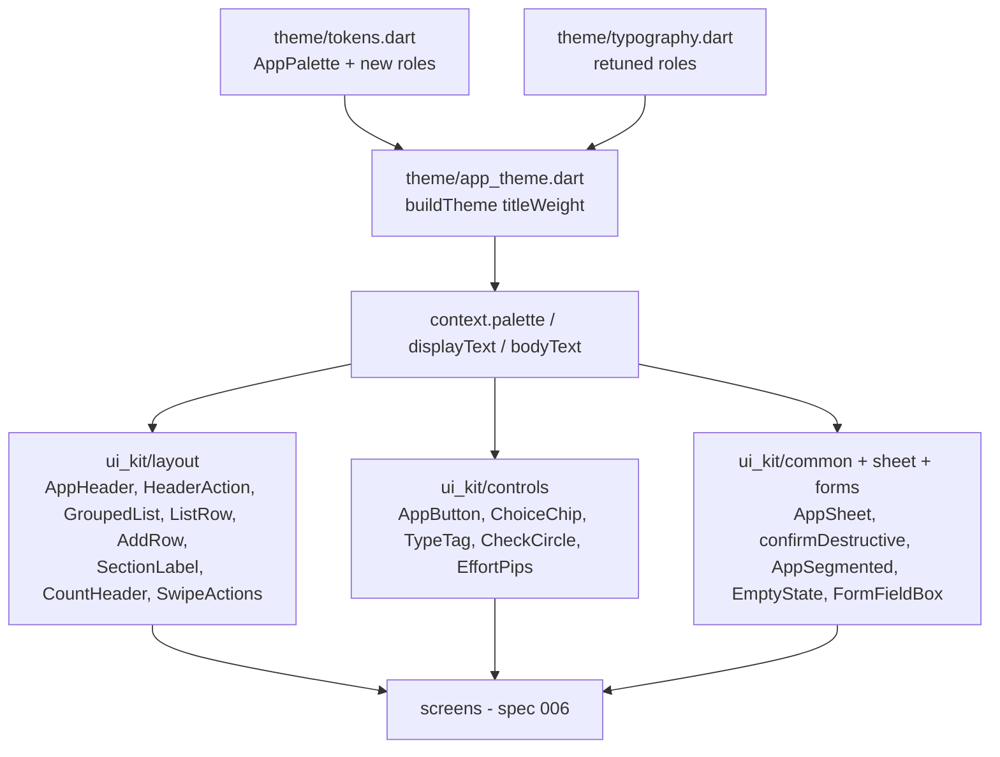

# Design Document: Design System

## Overview

This spec adds one visual language to DayLog without moving any screen yet. It extends the existing theme layer
(`lib/theme/`) with a few palette roles, retunes the typography and the glow, and adds the shared widgets that every
redesigned screen will be built from (`lib/ui_kit/`). Spec `005-module-navigation` and spec `006-screen-redesign`
consume these widgets; nothing here depends on them.

The look is defined by the Visual_Reference (`.design/redesign-preview/`, see its `README.md`). The two files to
keep open while implementing are `renders/light/r3-questadd.png` (sheet, Form_Field, Choice_Chip, Segmented_Control,
Primary_Button) and `renders/light/r3-mission.png` (App_Header, Grouped_List, Add_Row, Check_Circle, Effort_Pips),
plus `renders/*/r3-dialog.png` for the Confirm_Dialog. Every value in this document was read off those mockups; the
mockup CSS in `.design/redesign-preview/index.html` (`<style>` blocks, classes `.tb`, `.ib`, `.grp`, `.row-s`, `.ic`,
`.chip`, `.fld`, `.btn`, `.sg`, `.dlg`, `.sheet-h`) is the pixel source when a value is missing here.

**Key design decisions:**

- **Add roles, change no colour.** `tone`, `lineStrong`, `card` and the Glow roles are new fields on `AppPalette`
  with values for both brightnesses. The blue palette Martin chose on 2026-11-19 stays byte for byte; the old role
  names (`brass`, `slip*`, `board`) stay too (renaming them is listed in `.agents/REFACTOR.md`).
- **Title weight is a theme input.** `buildTheme` takes a `FontWeight titleWeight` (default `w600`) and applies it
  to the two title roles only. Spec 005 stores the Title_Weight experiment and feeds it in; this spec only makes the
  theme accept it.
- **New widgets go into two new `ui_kit` folders.** `lib/ui_kit/common/` already holds 13 Dart files; the new layout
  widgets go to `lib/ui_kit/layout/` and the new controls to `lib/ui_kit/controls/`, so no directory approaches the
  15-file limit of the Structure_Check.
- **Existing shared widgets are restyled in place.** `AppSheet`, `confirmDestructive`, `AppSegmented` and
  `EmptyState` keep their public API (one optional parameter is added at most), so every caller keeps compiling and
  takes the new look at once.
- **Shared, not module-owned.** The Check_Circle, Effort_Pips and the swipe row move to `ui_kit`, because spec 006
  needs them in `time_tracking/`, which may not import `quests/` or `notes/`.

## Architecture



The theme is built in `lib/app.dart` from the active `ThemeDefinition` (`lib/theme/theme_registry.dart`) for the light
and the dark palette. Widgets never read a palette directly; they call `context.palette`.

## Project Structure

```
lib/
├── theme/
│   ├── tokens.dart            # + tone, lineStrong, card, glow roles; + Radii/Metrics entries below
│   ├── typography.dart        # retuned roles, titleWeight parameter
│   ├── app_theme.dart         # buildTheme(titleWeight), input decoration theme, AppGlow helpers
│   └── theme_registry.dart    # unchanged
├── ui_kit/
│   ├── common/                # 13 files today, 11 after removing the two old headers
│   │   ├── empty_state.dart   # restyled, + icon parameter
│   │   ├── app_segmented.dart # restyled, + icon-only segments
│   │   ├── add_fab.dart       # glow from AppGlow
│   │   ├── screen_header.dart # REMOVED in spec 006 once unused
│   │   └── sub_page_header.dart # REMOVED in spec 006 once unused
│   ├── layout/                # NEW
│   │   ├── app_header.dart    # AppHeader, HeaderLeading
│   │   ├── header_action.dart # HeaderAction
│   │   ├── grouped_list.dart  # GroupedList, ListRow, IconTile, AddRow
│   │   ├── section_headers.dart # SectionLabel, CountHeader
│   │   └── swipe_actions.dart # SwipeActions, SwipeActionSpec (moved from notes/ui/widgets/swipe_row.dart)
│   ├── controls/              # NEW
│   │   ├── app_buttons.dart   # AppButton (primary, tonal, destructive), PillButton
│   │   ├── choice_chip.dart   # ChoiceChipX, TypeTag
│   │   ├── check_circle.dart  # CheckCircle (moved from quests/ui/cards/check_circle.dart)
│   │   └── effort_pips.dart   # EffortPips (replaces quests/ui/cards/difficulty_pips.dart)
│   ├── forms/
│   │   └── form_field_box.dart # NEW: FormFieldBox
│   └── sheet/
│       ├── app_sheet.dart     # new header layout
│       └── confirm_destructive.dart # new dialog layout + confirmAction
assets/icons/                  # + 16 SVG icons (Requirement 16)
test/ui_kit/layout/            # NEW tests, one file per widget file
test/ui_kit/controls/          # NEW tests
```

## Components and Interfaces

### 1. Palette roles (`lib/theme/tokens.dart`)

New fields on `AppPalette`. `card` defaults like `slip` does; the others are required so each palette states them.

```dart
class AppPalette {
  const AppPalette({
    // ... every existing parameter unchanged ...
    required this.tone,
    required this.lineStrong,
    Color? card,
    required this.glowRing,
    required this.glowRingBlur,
    required this.glowButton,
    required this.glowButtonBlur,
    required this.glowButtonOffsetY,
  }) : card = card ?? (brightness == Brightness.dark ? boardRaised : parchment);

  /// Neutral tinted fill: Header_Action, tonal buttons, segmented track, timeline track.
  final Color tone;

  /// Stronger hairline: ring track, empty pips, open Check_Circle, secondary button outline.
  final Color lineStrong;

  /// Fill of cards, Grouped_Lists and Form_Fields.
  final Color card;

  /// Glow of the timer ring arc and its Gaussian blur (logical px).
  final Color glowRing;
  final double glowRingBlur;

  /// Glow under round primary buttons, the add button, the module button and Primary_Buttons.
  final Color glowButton;
  final double glowButtonBlur;
  final double glowButtonOffsetY;
}
```

Token values (both palettes):

| Role | `daylight` (light) | `guildBoard` (dark) |
|---|---|---|
| `tone` | `0x0D15202B` | `0x0FE6EAF2` |
| `lineStrong` | `0x2115202B` | `0x24E6EAF2` |
| `card` | default → `parchment` `#FFFFFF` | default → `boardRaised` `#18202B` |
| `glowRing` | `0x4D2B7287` (brass 30 %) | `0x8C78B4C4` (brass 55 %) |
| `glowRingBlur` | `5` | `9` |
| `glowButton` | `0x522B7287` (brass 32 %) | `0x7378B4C4` (brass 45 %) |
| `glowButtonBlur` | `16` | `26` |
| `glowButtonOffsetY` | `4` | `0` |

Existing roles reused by the new widgets: `brass` (accent fill), `brassText` (accent text and icons), `brassSoft`
(accent-soft fill: Icon_Tile, level card, XP pill), `inkOnBrass`, `destructive`, `inkOnDestructive`, `boardLine`
(hairlines), `text`, `textDim`, `textFaint`, `sheet`, `scrim`.

New `Radii` and `Metrics` entries (the guard test forbids literals in UI code):

```dart
abstract final class Radii {
  // existing: card 14, control 12, sheet 24, reward 22, pill 999
  static const double group = 18;      // Grouped_List, Level card is 22 (reward)
  static const double field = 14;      // Form_Field (= card)
  static const double button = 16;     // Primary/Tonal/Destructive button
  static const double headerAction = 14;
  static const double iconTile = 10;
  static const double segment = 9;     // selected segment inside a 12 track
  static const double tag = 8;         // Type_Tag
  static const double chipSmall = 5;   // calendar Event_Chip (spec 006)
  static const double dialog = 26;
  static const double sheetTop = 28;   // sheet top corners (mockup); replaces 24 for bottom sheets
}

abstract final class Metrics {
  // existing entries unchanged
  static const double header = 64;
  static const double iconTile = 34;
  static const double listRowMin = 56;
  static const double buttonHeight = 54;
  static const double pillButton = 32;
  static const double checkCircle = 24;
  static const double pipWidth = 12;
  static const double pipHeight = 4;
  static const double chipDot = 8;
  static const double dialogIcon = 48;
  static const double emptyIcon = 64;
  static const double badge = 18;
}
```

### 2. Typography (`lib/theme/typography.dart`)

```dart
/// Default weight of page and sheet titles (the Title_Weight experiment of spec 005 overrides it).
const FontWeight defaultTitleWeight = FontWeight.w600;

TextTheme buildDisplayTextTheme(AppPalette p, {FontWeight titleWeight = defaultTitleWeight});
TextTheme buildBodyTextTheme(AppPalette p);
```

| Role | Size | Weight | Use |
|---|---|---|---|
| `display.displayLarge` | 48 | 800 | reward figure (unchanged) |
| `display.displayMedium` | 28 | 700 | detail title (Mission name, event title) — NEW |
| `display.displaySmall` | 26 | 600 | note editor title — NEW |
| `display.headlineLarge` | 22 | Title_Weight | page title in App_Header (was 34 / 700) |
| `display.headlineMedium` | 22 | Title_Weight | sheet title (was 24 / 700) |
| `display.titleLarge` | 20 | 700 | level text, hero names (unchanged) |
| `display.titleMedium` | 17 | 700 | XP figures (unchanged) |
| `body.titleLarge` | 17 | 700 | Count_Header title — NEW |
| `body.titleMedium` | 16 | 600 | card / row title (unchanged) |
| `body.bodyLarge` | 15 | 400 | running text (unchanged) |
| `body.bodyMedium` | 15 | 500 | (unchanged) |
| `body.bodySmall` | 12.5 | 400 | meta line, header subtitle (unchanged) |
| `body.labelLarge` | 15 | 600 | buttons inside rows (unchanged) |
| `body.labelSmall` | 12 | 700, letter spacing 0.09 em | Section_Label (was 11 / 600 / 0.14 em) |

Display roles keep the `-0.02 × size` letter spacing and tabular figures.

### 3. Theme (`lib/theme/app_theme.dart`)

```dart
ThemeData buildTheme({required AppPalette palette, FontWeight titleWeight = defaultTitleWeight});

/// Glow helpers so widgets never build shadows by hand.
abstract final class AppGlow {
  /// BoxShadow list for round primary buttons, the add button, the module button and Primary_Buttons.
  static List<BoxShadow> button(AppPalette p);

  /// Paint for the glow pass of the timer ring arc (MaskFilter.blur with glowRingBlur).
  static Paint ring(AppPalette p, {required double strokeWidth});
}
```

`buildTheme` also sets `inputDecorationTheme` to the Form_Field look: `filled: true`, `fillColor: p.card`,
`contentPadding: EdgeInsets.symmetric(vertical: 10, horizontal: 14)` (through `Space`), `enabledBorder` and `border`
as a hairline `boardLine` `OutlineInputBorder` with `Radii.field`, `focusedBorder` as a 2 px `brass` border,
`hintStyle` 16 px `textFaint`, `labelStyle`/`floatingLabelStyle` 12 px w600 `textFaint`. It also sets
`datePickerTheme` and `timePickerTheme` (Requirement 11.6): `backgroundColor: p.sheet`, `surfaceTintColor:
transparent`, header and day/hour selection in `brass` with `inkOnBrass`, other text in `text`/`textDim`, shape with
`Radii.dialog`; the pickers keep their Material behaviour. `lib/app.dart` passes the
title weight it receives from spec 005 (until then the default).

### 4. AppHeader (`lib/ui_kit/layout/app_header.dart`)

```dart
enum HeaderLeading { menu, back, close, none }

/// The header row of every screen (Requirement 3). Leading element, title (+ subtitle), up to two trailing widgets.
class AppHeader extends StatelessWidget {
  const AppHeader({
    super.key,
    required this.title,
    this.subtitle,
    this.leading = HeaderLeading.menu,
    this.onLeading,          // default: back/close pop the route, menu opens the drawer
    this.trailing = const <Widget>[], // at most 2: HeaderAction or AppSegmented
  });
  final String title;
  final String? subtitle;
  final HeaderLeading leading;
  final VoidCallback? onLeading;
  final List<Widget> trailing;
}
```

Layout: `SizedBox(height: Metrics.header)`, horizontal padding `Space.s12`, `Row` of leading (44 × 44), title column
(`Expanded`, `headlineLarge`, one line, ellipsis; subtitle `bodySmall` `textDim`), `Space.s6` gaps, trailing
widgets. `HeaderLeading.menu` renders the existing `MenuButton` (which draws nothing without a `ShellMenuScope`;
spec 005 adds the Drawer_Enabled switch to it). When the leading element draws nothing, the title starts after
`Space.s8`. `assert(trailing.length <= 2)`.

### 5. HeaderAction (`lib/ui_kit/layout/header_action.dart`)

```dart
class HeaderAction extends StatelessWidget {
  const HeaderAction({
    super.key,
    required this.icon,          // IconAsset name
    required this.semanticLabel,
    required this.onPressed,
    this.badgeCount,             // shows a brass pill when > 0
  });
}
```

44 × 44, `Radii.headerAction`, `tone` fill, `AppIcon` 24 px `textDim`, no splash (the theme already removes it).

### 6. GroupedList, ListRow, IconTile, AddRow (`lib/ui_kit/layout/grouped_list.dart`)

```dart
class GroupedList extends StatelessWidget {
  const GroupedList({super.key, required this.children});
  final List<Widget> children; // rows; dividers are inserted between them
}

class ListRow extends StatelessWidget {
  const ListRow({
    super.key,
    required this.title,
    this.subtitle,
    this.leading,        // usually IconTile or CheckCircle
    this.value,          // trailing text
    this.trailing,       // trailing widget (switch, segmented, pill); wins over value
    this.showChevron = false,
    this.onTap,
    this.dimmed = false, // whole row at 50 % opacity (inactive reminder)
  });
}

class IconTile extends StatelessWidget {
  const IconTile(this.icon, {super.key, this.size = Metrics.iconTile});
}

class AddRow extends StatelessWidget {
  const AddRow({super.key, required this.label, required this.onTap});
}
```

`GroupedList`: `DecoratedBox` with `card` fill, hairline `boardLine` border, `Radii.group`, `ClipRRect`; rows
separated by `Divider(height: Metrics.hairline)`. `ListRow` builds one `Semantics(button: onTap != null)` node
combining title, subtitle and value.

### 7. SectionLabel, CountHeader (`lib/ui_kit/layout/section_headers.dart`)

```dart
class SectionLabel extends StatelessWidget {
  const SectionLabel(this.text, {super.key}); // upper-cased labelSmall, textFaint, header semantics
}

class CountHeader extends StatelessWidget {
  const CountHeader({super.key, required this.title, this.count, this.trailing});
  final String title;   // body.titleLarge
  final int? count;     // textFaint, w600
  final Widget? trailing; // e.g. an XP pill
}
```

`SettingsGroup` (`lib/ui_kit/common/settings_group.dart`) becomes a thin wrapper of `SectionLabel` + child so that
existing callers keep working.

### 8. SwipeActions (`lib/ui_kit/layout/swipe_actions.dart`)

Moved from `lib/notes/ui/widgets/swipe_row.dart` (same `flutter_slidable` implementation), generalised:

```dart
class SwipeActionSpec {
  const SwipeActionSpec({required this.label, required this.semanticLabel, required this.icon,
      required this.background, required this.foreground, required this.onPressed, required this.actionKey});

  /// The two standard actions of Requirement 6.
  factory SwipeActionSpec.edit(BuildContext context, {required VoidCallback onPressed, required Key key});
  factory SwipeActionSpec.delete(BuildContext context, {required VoidCallback onPressed, required Key key});
}

class SwipeActions extends StatelessWidget {
  const SwipeActions({super.key, required this.groupTag, required this.actions, required this.child});
}
```

`notes/ui/widgets/swipe_row.dart` re-exports or is replaced by the shared widget (Notes keeps three actions); Quests
and Missions keep their own `Slidable` rows unless a move changes nothing.

### 9. AppSheet header (`lib/ui_kit/sheet/app_sheet.dart`)

Public API unchanged plus one optional parameter:

```dart
const AppSheet({
  super.key,
  required this.title,
  this.primaryLabel,
  required this.child,
  this.primaryIcon,
  this.onPrimary,
  this.primaryEnabled = true,
  this.isDirty = false,
  this.headerAction, // NEW: optional HeaderAction shown before the close button
});
```

`_Header` becomes: `Row(Expanded(Text(title, headlineMedium, left)), headerAction?, HeaderAction(close))` with
`Space.s10` gaps; the close action calls the existing cancel path (discard question when dirty). `_PrimaryButton`
becomes an `AppButton.primary` at full width. Top corners use `Radii.sheetTop`. The grabber stays.

### 10. Confirm dialog (`lib/ui_kit/sheet/confirm_destructive.dart`)

```dart
/// Existing: destructive confirmation (red button, alert icon). Contract unchanged.
Future<bool> confirmDestructive(BuildContext context,
    {required String title, required String body, required String confirmLabel, String? cancelLabel});

/// NEW: non-destructive confirmation (brass button, accent icon), e.g. "Vyvěsit hned".
Future<bool> confirmAction(BuildContext context,
    {required String title, required String body, required String confirmLabel, String? cancelLabel, String icon = IconAsset.check});
```

Dialog body: `Dialog` with `sheet` fill, `Radii.dialog`, `insetPadding` 26 horizontal; column of icon badge
(48 px circle; destructive: `destructive` at 22 % fill and `destructive` icon `alert`; action: `brassSoft` fill and
`brassText` icon), `Space.s4`, title (21 px w700 display face), body (15.5 px `textDim`, may wrap over several lines;
the dialog content scrolls when it is taller than the screen, as the import summary can be), `Space.s10`, buttons in a
`Row` of two `Expanded` buttons with `Space.s10` gap; a `LayoutBuilder` falls back to a `Column` when either label
needs more than half the width (large text).

### 11. Buttons (`lib/ui_kit/controls/app_buttons.dart`)

```dart
enum AppButtonKind { primary, tonal, destructive }

class AppButton extends StatelessWidget {
  const AppButton({super.key, required this.label, required this.onPressed, this.kind = AppButtonKind.primary,
      this.icon, this.expand = true});
  const AppButton.primary(...); const AppButton.tonal(...); const AppButton.destructive(...);
  final VoidCallback? onPressed; // null = disabled (45 % opacity, no glow)
}

class PillButton extends StatelessWidget {
  const PillButton({super.key, required this.label, required this.onPressed}); // 32 high, tonal, 44 hit area
}
```

### 12. ChoiceChipX and TypeTag (`lib/ui_kit/controls/choice_chip.dart`)

```dart
class ChoiceChipX extends StatelessWidget { // name avoids Material's ChoiceChip
  const ChoiceChipX({super.key, required this.label, required this.selected, required this.onSelected,
      this.color, this.showDot = false});
}

class TypeTag extends StatelessWidget {
  const TypeTag({super.key, required this.label, required this.color});
}

/// Shared colour maths of Requirement 9.
Color tintFill(Color c, Color over, double amount); // Color.lerp(over, c, amount)
Color tintInk(Color c, Color text, double amount);  // Color.lerp(text, c, amount)
```

Selected Choice_Chip: fill `tintFill(color, p.card, 0.20)`, border `color.withValues(alpha: 0.5)`, label
`tintInk(color, p.text, 0.45)`. Type_Tag: fill `tintFill(color, p.card, 0.20)`, label `tintInk(color, p.text, 0.45)`.

### 13. CheckCircle and EffortPips (`lib/ui_kit/controls/`)

```dart
class CheckCircle extends StatelessWidget {
  const CheckCircle({super.key, required this.checked, required this.semanticLabel, this.onTap});
}

class EffortPips extends StatelessWidget {
  const EffortPips({super.key, required this.filled, this.total = 4});
}
```

The current `quests/ui/cards/check_circle.dart` behaviour (tap target, haptic, animation under reduced motion) is
kept and only the look changes; its nine importers switch to the shared file.

### 14. FormFieldBox (`lib/ui_kit/forms/form_field_box.dart`)

```dart
/// A tappable value field (date, time, picker) with the Form_Field look.
class FormFieldBox extends StatelessWidget {
  const FormFieldBox({super.key, this.label, this.value, this.placeholder, this.onTap, this.focused = false, this.trailing});
}
```

### 15. Restyled existing widgets

- `AppSegmented` (`lib/ui_kit/common/app_segmented.dart`): track `tone`, `Radii.control`, padding `Space.s2 + 1`
  (3 px through a new `Space.s3` token); selected segment `card` fill, `Radii.segment`, light-theme shadow
  (`0 1 2 / 5 %` and `0 6 18 / 6 %` of text colour); labels w600, selected `brassText`, others `textDim`;
  `SegmentedOption` gets an optional `icon` and a required `semanticLabel` when the label is empty.
- `EmptyState` (`lib/ui_kit/common/empty_state.dart`): new optional `icon` (default `IconAsset.note`); layout per
  Requirement 14; `BlankSlip` stays available for the Quest board's empty state only if spec 006 keeps it (it does
  not: Requirement 19 of spec 006 replaces it).
- `AddFab` (`lib/ui_kit/common/add_fab.dart`): shadow from `AppGlow.button`; 58 px, `Radii.button + 2` (18).
- `AppThemeData.fromPalette` (`lib/time_tracking/theme/time_theme.dart`): `glow` and `glowSoft` come from
  `glowRing`; `ring_painter.dart` uses `AppGlow.ring` and the `lineStrong` track.

## Data Models

No data or schema changes.

## Correctness Properties

### Property 1: Palette roles exist for every theme brightness

*For any* `ThemeDefinition` in `themeRegistry` and either brightness, THE App_Palette SHALL define `tone`,
`lineStrong`, `card` and the five Glow roles, with the values of the token table for the blue theme.

**Validates: Requirements 1.2, 1.3, 1.4, 1.5**

### Property 2: Title weight touches only the title roles

*For any* Title_Weight in {500, 600, 700, 800}, THE Typography built with it SHALL differ from the one built with
600 only in the weight of `headlineLarge` and `headlineMedium`.

**Validates: Requirements 2.1, 2.2, 2.7**

### Property 3: Selected chip labels stay readable

*For any* activity colour and calendar Event_Type colour and either palette, the label colour of a selected
Choice_Chip on its fill SHALL reach a contrast ratio of at least 4.5 : 1.

**Validates: Requirements 9.3, 17.4**

## Error Handling

The design system has no runtime failure paths of its own.

| Category | Trigger | Behavior |
|---|---|---|
| Misuse | `AppHeader` with more than two trailing widgets | `assert` fails in debug; release shows the first two |
| Missing icon | `AppIcon` with an unknown name | existing asset test fails (`test/assets_test.dart`) |
| Missing label | `HeaderAction` or icon-only segment without a semantics label | constructor requires it (compile error) |

## Testing Strategy

- **Widget tests** (`flutter_test`, harness `test/ui_kit/common/_harness.dart`): one file per new widget file in
  `test/ui_kit/layout/` and `test/ui_kit/controls/`, checking sizes, colours (read from the palette), states and
  semantics; updated tests for `app_sheet_test.dart`, `confirm_destructive_test.dart`, `app_segmented_test.dart`,
  `empty_state_test.dart`.
- **Property tests** (`glados`, already a dev dependency; hide clashing symbols): Properties 1–3 in
  `test/theme/tokens_test.dart`, `test/theme/theme_test.dart` and `test/theme/contrast_test.dart`.
  Tags: `Feature: design-system, Property N: <title>`.
- **Guards**: `token_usage_test.dart`, `clock_usage_test.dart`, `assets_test.dart` unchanged and green.
- **Goldens**: `flutter test --update-goldens test/goldens` once at the end; review every changed image (titles get
  smaller and lighter, sheet headers change) and commit them with the spec.
- **Gate**: `scripts/check.sh`.
