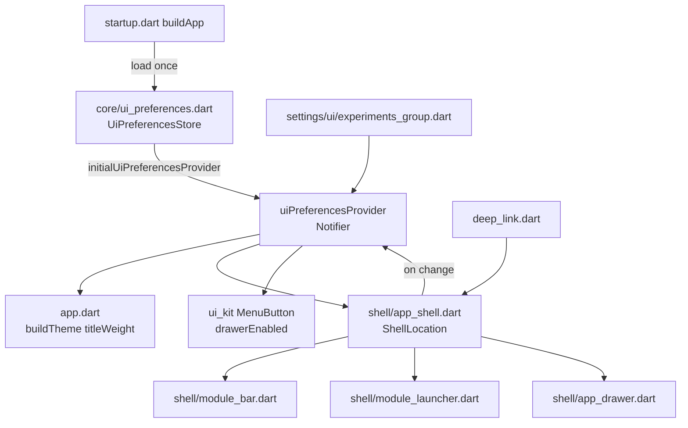
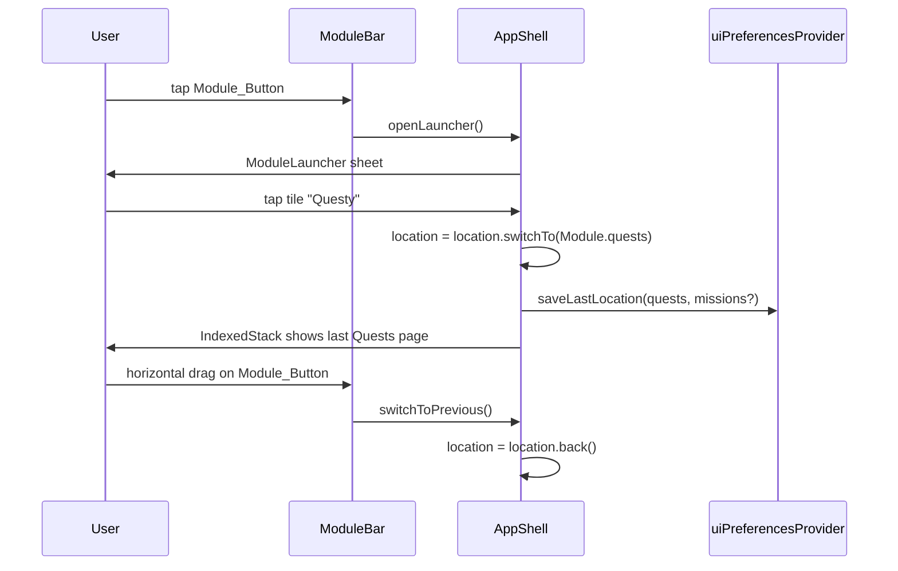
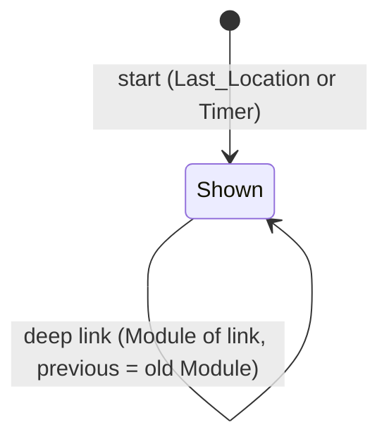

# Design Document: Module Navigation

## Overview

The Shell keeps its single `IndexedStack` of eight Destinations; what changes is how the user moves between them.
A new `Module` enum groups the Destinations; the five-tab `BottomBar` is replaced by a `ModuleBar` that shows the
Module_Button and the pages of the current Module; a `ModuleLauncher` sheet switches Modules; the Drawer is rebuilt
around Modules; and a small device-local preference store keeps the Experiment_Settings and the Last_Location.

Visual reference (read `.design/redesign-preview/README.md` first):

- `renders/{light,dark}/r2-nav2-timer.png`, `r2-nav2-quests.png`, `r2-nav2-calendar.png` — the Module_Bar with three,
  two and one Module_Page. These mockups draw no Menu_Button in the header (they assume the drawer is off); with
  Drawer_Enabled on, the header shows the Menu_Button as in `r2-nav1-timer.png`.
- `renders/*/r2-nav2-timer-launcher.png` — the Module_Launcher.
- `renders/*/r2-nav1-timer-drawer.png` — the Drawer content (its bottom bar is the rejected variant 1; ignore it).
- `round2.html`, section „Varianta 2“, has a clickable prototype of the launcher and the previous-module gesture
  (double-click stands in for the drag).

**Key design decisions:**

- **Modules are derived, Destinations stay.** `Destination` keeps its values, order, link names and the
  `IndexedStack` index, so deep links, the shortcut screen and the page state are untouched. `Module` is a new enum
  with a `pages` list; `Destination.module` replaces `Destination.tab`.
- **Navigation state is one small object.** `ShellLocation` (current Module, page per Module, Previous_Module) lives
  in the Shell state and is mirrored to the device preferences on every change, so start-up and deep links have one
  place to read and write.
- **Device preferences outside the database.** Experiment_Settings and the Last_Location are view preferences of
  one device. They live in SharedPreferences under `ui_` keys, are loaded once in `buildApp` before the first frame
  (like the calendar Type_Filter) and are excluded from import, so an export from another device never moves them.
- **The store lives in `lib/core/`.** The Settings page (`lib/settings/`) must not import `lib/shell/`
  (`test/architecture/feature_imports_test.dart`), and the theme in `lib/app.dart` needs the Title_Weight, so the
  preference store and its providers go to `lib/core/ui_preferences.dart`, which every layer may import.
- **The drawer edge drag comes back, guarded.** It was disabled because it collided with list gestures. The Drawer
  now opens from a 20 logical pixel left edge only (`drawerEdgeDragWidth`), which no list row uses (their swipe
  actions open with a leftward drag), and only while Drawer_Enabled is on. Pushed routes are not under the Shell's
  Scaffold, so the iOS back swipe on them is unaffected.

## Architecture





## Project Structure

```
lib/
├── core/
│   └── ui_preferences.dart        # NEW: UiPreferences, UiPreferencesStore, providers, ModuleButtonSide
├── shell/                         # 7 files today → 9
│   ├── module.dart                # NEW: Module enum, ShellLocation
│   ├── module_bar.dart            # NEW: ModuleBar, ModuleButton (replaces bottom_bar.dart)
│   ├── module_launcher.dart       # NEW: showModuleLauncher, ModuleLauncher
│   ├── app_drawer.dart            # REWRITTEN: modules with page chips
│   ├── app_shell.dart             # CHANGED: ShellLocation, launcher, gesture, persistence, edge drag
│   ├── destination.dart           # CHANGED: Destination.module; tabs/tab/group removed
│   ├── bottom_bar.dart            # REMOVED
│   ├── deep_link.dart             # unchanged
│   ├── reconcile_banner.dart      # unchanged
│   └── splash_screen.dart         # unchanged
├── settings/ui/
│   └── experiments_group.dart     # NEW: the Experiments group of the Settings page
├── database/import/
│   └── preferences_writer.dart    # CHANGED: ignore the ui_ prefix
├── ui_kit/common/menu_button.dart # CHANGED: draws nothing while the drawer is disabled
└── startup.dart, app.dart         # CHANGED: load preferences, pass titleWeight
test/
├── core/ui_preferences_test.dart  # NEW
└── shell/                         # module_test, module_bar_test, module_launcher_test, app_drawer_test (NEW); bottom_bar_test REMOVED
```

## Components and Interfaces

### 1. Module and ShellLocation (`lib/shell/module.dart`)

```dart
/// A group of Destinations shown together in the Module_Bar (Requirement 1).
enum Module {
  time(<Destination>[Destination.timer, Destination.history, Destination.statistics]),
  quests(<Destination>[Destination.quests, Destination.missions]),
  calendar(<Destination>[Destination.calendar]),
  notes(<Destination>[Destination.notes]),
  settings(<Destination>[Destination.settings]);

  const Module(this.pages);
  final List<Destination> pages;

  /// The Modules shown as tiles in the Module_Launcher and as rows in the Drawer (all but settings).
  static List<Module> get launchable;

  String get icon;                      // IconAsset: timer, quests, calendar, notes, gear
  String label(AppLocalizations l);     // shell_tabTimer, app_tabQuests, app_tabCalendar, app_tabNotes, app_tabSettings
}

/// The navigation state of the Shell (Requirements 3.7, 4, 5).
@immutable
class ShellLocation {
  const ShellLocation({required this.module, required this.pageOf, this.previous});

  /// The start state: Time / Timer, no Previous_Module.
  factory ShellLocation.initial();

  /// The state for a stored or linked Destination.
  factory ShellLocation.at(Destination destination);

  final Module module;
  final Map<Module, Destination> pageOf; // last shown page per Module (session only)
  final Module? previous;

  Destination get destination;          // pageOf[module] ?? module.pages.first

  /// Show [destination]; when its Module differs, the current Module becomes [previous].
  ShellLocation show(Destination destination);

  /// Switch to [module] at its remembered page; no-op when it is the current one.
  ShellLocation switchTo(Module module);

  /// Switch to [previous]; returns this when there is none.
  ShellLocation back();
}
```

`Destination` (`lib/shell/destination.dart`) gains `Module get module` (the Module whose `pages` contains it) and
loses `tabs`, `tab`, `isTab`, `group`, `DestinationGroup` and `drawerItems` once nothing uses them.

### 2. Device preferences (`lib/core/ui_preferences.dart`)

```dart
enum ModuleButtonSide { left, right }

@immutable
class UiPreferences {
  const UiPreferences({
    this.moduleButtonSide = ModuleButtonSide.left,
    this.drawerEnabled = true,
    this.titleWeight = FontWeight.w600,
    this.lastLocation,              // Destination link name, e.g. "missions"; null when none
  });
  final ModuleButtonSide moduleButtonSide;
  final bool drawerEnabled;
  final FontWeight titleWeight;     // one of w500, w600, w700, w800
  final String? lastLocation;
  UiPreferences copyWith({...});
}

/// SharedPreferences keys (Requirement 8.8, 5.2). All start with `ui_`.
abstract final class UiPreferenceKeys {
  static const String moduleButtonSide = 'ui_module_button_side'; // "left" | "right"
  static const String drawerEnabled = 'ui_drawer_enabled';        // bool
  static const String titleWeight = 'ui_title_weight';            // int 500..800
  static const String lastLocation = 'ui_last_location';          // Destination link name
}

abstract interface class UiPreferencesStore {
  Future<UiPreferences> load();          // invalid or missing values → defaults (Requirement 8.9)
  Future<void> save(UiPreferences value);
}

class SharedPrefsUiPreferencesStore implements UiPreferencesStore {
  SharedPrefsUiPreferencesStore(this._prefs);
  final SharedPreferences _prefs;
}

/// Overridden in buildApp with the loaded value and the real store; tests override with fakes.
final initialUiPreferencesProvider = Provider<UiPreferences>((ref) => const UiPreferences());
final uiPreferencesStoreProvider = Provider<UiPreferencesStore>((ref) => throw UnimplementedError());

class UiPreferencesNotifier extends Notifier<UiPreferences> {
  @override
  UiPreferences build();                                 // ref.read(initialUiPreferencesProvider)
  Future<void> setModuleButtonSide(ModuleButtonSide side);
  Future<void> setDrawerEnabled(bool enabled);
  Future<void> setTitleWeight(FontWeight weight);
  Future<void> setLastLocation(String linkName);         // a Destination.linkName
}
final uiPreferencesProvider = NotifierProvider<UiPreferencesNotifier, UiPreferences>(UiPreferencesNotifier.new);
```

`lib/core/` may not import `lib/shell/`, so the notifier stores the link name as a `String`; the Shell converts with
`Destination.values` and `linkName`. Writes are fire-and-forget after the state
update, so the UI never waits for disk.

### 3. Start-up and theme (`lib/startup.dart`, `lib/app.dart`)

`buildApp` creates `SharedPrefsUiPreferencesStore(await SharedPreferences.getInstance())`, awaits `load()` and adds
`initialUiPreferencesProvider.overrideWithValue(loaded)` and `uiPreferencesStoreProvider.overrideWithValue(store)` to
the container (same pattern as `calendarFilterStoreProvider`). `AppShell.initial` becomes the stored Destination when
there is one and no launching Deep_Link. `DayLogApp` (`lib/app.dart`) watches
`uiPreferencesProvider.select((p) => p.titleWeight)` and passes it to `buildTheme` for both palettes.
`test/startup_test.dart` gets a fake store.

### 4. ModuleBar and ModuleButton (`lib/shell/module_bar.dart`)

```dart
class ModuleBar extends StatelessWidget {
  const ModuleBar({
    super.key,
    required this.location,               // current Module and shown page
    required this.side,                   // ModuleButtonSide
    required this.hasPrevious,
    required this.onSelectPage,           // ValueChanged<Destination>
    required this.onOpenLauncher,         // VoidCallback
    required this.onPreviousModule,       // VoidCallback
  });
}

class ModuleButton extends StatelessWidget {
  const ModuleButton({super.key, required this.module, required this.onTap, required this.onSwipe, required this.hasPrevious});
}
```

Layout (values via tokens; add `Metrics.moduleButton = 50`, `Metrics.moduleSlot = 66`, `Metrics.barContent = 66`,
`Metrics.singleTabMax = 92`, `Radii.moduleButton = 16`): `DecoratedBox(boardRaised, top hairline boardLine)` →
`SafeArea(top: false)` → `SizedBox(height: Metrics.barContent)` → `Row` of
`[ModuleButton slot, separator, tabs]` (mirrored for `right`: `[tabs, separator, slot]`). Tabs: `Expanded` each when
the Module has more than one page; one tab in a `ConstrainedBox(maxWidth: 92)` aligned to the separator otherwise.
Tab: `AppIcon` 24 px + `Space.s4` + label 12 px w500 (w700 selected), colour `brassText` when selected, otherwise
`text.withValues(alpha: 0.58)`; no ink, no pill. The ModuleButton uses a `GestureDetector` with `onTap` and
`onHorizontalDragUpdate` accumulating `delta.dx`; at `|sum| >= 24` it calls `onSwipe` once per drag and
`Haptics.light()`; semantics label `shell_moduleButtonLabel(moduleName)` and, while `hasPrevious`, the custom action
`shell_previousModule`. Keys: `moduleBarTabKey(Destination)`, `moduleButtonKey`.

### 5. ModuleLauncher (`lib/shell/module_launcher.dart`)

```dart
/// Opens the launcher; resolves to the chosen Module or null when dismissed.
Future<Module?> showModuleLauncher(BuildContext context, {required Module current});

class ModuleLauncher extends StatelessWidget {
  const ModuleLauncher({super.key, required this.current});
}
```

Built on `showAppSheet` + `AppSheet(title: l.shell_modulesTitle)` without a primary button. Body: `GridView` with
two columns, `Space.s12` gaps, `shrinkWrap`, tiles per Requirement 3.3/3.4 (`Radii.tile = 20`, `Metrics.tileMin =
112`, `Metrics.launcherIcon = 40`, `Radii.launcherIcon = 12`); then `GroupedList` with one `ListRow` (Icon_Tile
`gear`, `app_tabSettings`, chevron); then the hint `shell_launcherHint`. A tap calls `AppSheet.close(context, module)`.
Keys: `launcherTileKey(Module)`.

### 6. Drawer (`lib/shell/app_drawer.dart`)

```dart
class AppDrawer extends StatelessWidget {
  const AppDrawer({super.key, required this.current, required this.onSelectModule, required this.onSelectPage});
  final Module current;
  final ValueChanged<Module> onSelectModule;
  final ValueChanged<Destination> onSelectPage;
}
```

`Drawer(backgroundColor: sheet, shape: right corners Radii.dialog)`, width 312, padding 22/16. Title „DayLog“
26/800. Rows per Requirement 6.2/6.3 (`Metrics.drawerIcon = 42`, `Radii.drawerIcon = 13`, row radius 16). Chips
(`Wrap`, gap `Space.s6`, padding-left 68) for `module.pages.skip(1)`. `Spacer`, hairline, Settings row. Keys keep the
`drawerItemKey(Destination)` scheme for chips and add `drawerModuleKey(Module)`.

### 7. AppShell (`lib/shell/app_shell.dart`)

Changes only; Reconciliation, snackbar and splash logic stay.

```dart
class _AppShellState extends ConsumerState<AppShell> with WidgetsBindingObserver {
  late ShellLocation _location = ShellLocation.at(widget.initial);

  void _show(Destination d);           // replaces _select: clears snackbars, refreshes statistics, setState, persists
  void _switchModule(Module m);        // _location.switchTo + persist
  void _previousModule();              // _location.back + persist (no-op without previous)
  Future<void> _openLauncher();        // await showModuleLauncher; then _switchModule
}
```

`Scaffold(drawer: drawerEnabled ? AppDrawer(...) : null, drawerEnableOpenDragGesture: drawerEnabled,
drawerEdgeDragWidth: Metrics.drawerEdge /* 20 */)`. `_buildPages` keeps the `IndexedStack` (index
`_location.destination.index`) and replaces `BottomBar` with `ModuleBar`. `_openLink` calls `_show(destination)` after
popping to the first route (Requirement 5.5, 9.1). `ShellMenuScope.openPage` calls `_show`. Persisting calls
`ref.read(uiPreferencesProvider.notifier).setLastLocation(destination.linkName)`.

### 8. Headers of the module pages

Minimal changes in this spec (the full restyle is spec 006):

- `lib/time_tracking/ui/screens/timer_screen.dart`: header becomes `AppHeader(title: l.shell_tabTimer)` without the
  History/Statistics buttons.
- `lib/time_tracking/ui/screens/history_screen.dart`, `statistics_screen.dart`: drop `onBack` from their header;
  use `AppHeader(leading: HeaderLeading.menu, ...)`.
- `lib/quests/ui/missions/missions_screen.dart`: no back button.
- `lib/ui_kit/common/menu_button.dart`: `MenuButton` also draws nothing when
  `ref.watch(uiPreferencesProvider).drawerEnabled` is false (it becomes a `ConsumerWidget`).

### 9. Experiments group (`lib/settings/ui/experiments_group.dart`)

```dart
class ExperimentsGroup extends ConsumerWidget {
  const ExperimentsGroup({super.key});
}
```

`SectionLabel(l.settings_groupExperiments)` + `GroupedList` of three `ListRow`s with trailing controls:
`AppSegmented<ModuleButtonSide>` (`settings_moduleButtonLeft` / `Right`), `Switch` (`settings_drawerEnabled`),
`AppSegmented<FontWeight>` with labels `500` `600` `700` `800`. Inserted by `settings_screen.dart` directly before the
About group.

### 10. Import (`lib/database/import/preferences_writer.dart`)

`isImportedPreference(key)` also returns false for keys starting with `ui_` (new constant
`ignoredUiPreferencePrefix = 'ui_'`). The exporter keeps exporting every key; the importer skips these.

### New strings (both ARB files, descriptions in `app_cs.arb`)

| Key | cs | en |
|---|---|---|
| `shell_modulesTitle` | Moduly | Modules |
| `shell_launcherHint` | Tip: přejetím po tlačítku modulu se vrátíš na předchozí modul | Tip: swipe across the module button to go back to the previous module |
| `shell_moduleButtonLabel` | {module}, přepnout modul | {module}, switch module |
| `shell_previousModule` | Předchozí modul | Previous module |
| `settings_groupExperiments` | Experimenty | Experiments |
| `settings_moduleButtonSide` | Tlačítko modulů | Module button |
| `settings_moduleButtonLeft` | Vlevo | Left |
| `settings_moduleButtonRight` | Vpravo | Right |
| `settings_drawerEnabled` | Boční menu | Side menu |
| `settings_titleWeight` | Tloušťka nadpisů | Title weight |

`shell_groupTime` and `shell_groupPlanning` are removed with the old Drawer groups (also from both ARB files).

## Data Models

`ShellLocation` state machine:



Preference values:

| Key | Type | Valid values | Default |
|---|---|---|---|
| `ui_module_button_side` | String | `left`, `right` | `left` |
| `ui_drawer_enabled` | bool | true, false | true |
| `ui_title_weight` | int | 500, 600, 700, 800 | 600 |
| `ui_last_location` | String | a `Destination.linkName` | none → `timer` |

## Correctness Properties

### Property 1: Every Destination belongs to exactly one Module

*For any* `Destination`, exactly one `Module` SHALL list it in `pages`, and `destination.module` SHALL be that Module.

**Validates: Requirements 1.2, 1.4**

### Property 2: Navigation sequences keep a consistent location

*For any* sequence of `show`, `switchTo` and `back` operations starting from `ShellLocation.initial()`, the shown
Destination SHALL belong to the current Module, `previous` SHALL never equal the current Module, and `switchTo(m)`
SHALL show the page last shown in `m` (or its first page).

**Validates: Requirements 3.7, 3.8, 4.1, 4.2, 4.3, 5.1**

### Property 3: Preferences round-trip and fall back

*For any* `UiPreferences` value, `save` followed by `load` SHALL return an equal value; *for any* stored map with
missing or invalid `ui_` values, `load` SHALL return the defaults for those fields.

**Validates: Requirements 5.2, 5.4, 8.8, 8.9**

### Property 4: Import never touches device UI preferences

*For any* export map, `writePreferences` SHALL write no key that starts with `ui_`.

**Validates: Requirements 8.10**

## Error Handling

| Category | Trigger | Behavior |
|---|---|---|
| Storage read | SharedPreferences unavailable or a value of the wrong type | `load` returns defaults; the App starts on the Timer |
| Storage write | Saving a preference throws | Ignored; the in-memory state stays; the next change writes again |
| Unknown location | Stored link name no longer exists | Treated as missing (Timer) |
| Deep link | Unknown link | Ignored (existing `destinationFromUri`) |

## Testing Strategy

- **Unit tests** (`flutter_test`): `test/core/ui_preferences_test.dart` (store with `SharedPreferences.setMockInitialValues`),
  `test/shell/module_test.dart` (Module assignment, `ShellLocation`), `test/database/import/...` (ui_ prefix ignored).
- **Property tests** (`glados`, hide clashing names): Properties 1–4, tags `Feature: module-navigation, Property N: <title>`.
- **Widget tests**: `test/shell/module_bar_test.dart` (three, two, one page; left and right; selected colours; drag
  threshold; semantics action), `module_launcher_test.dart` (tiles, current tile, Settings row, hint, result),
  `app_drawer_test.dart` (rows, chips, selection, disabled drawer), `test/settings/ui/experiments_group_test.dart`,
  and updated `test/shell/app_shell_test.dart` (start on Last_Location, deep link, previous module, snackbar cleared
  on page change, statistics refresh). Remove `test/shell/bottom_bar_test.dart`; update `destination_test.dart`.
- **Startup**: `test/startup_test.dart` with a fake `UiPreferencesStore`, still under its time limit.
- **Real app**: start the Linux app (skill `sandbox-flutter-linux-run`), screenshot the Timer with the Module_Bar,
  the open launcher, the Quests module and the right-side variant; compare with `renders/*/r2-nav2-*.png`.
- **Gate**: `scripts/check.sh`.
