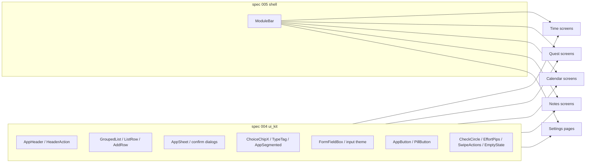

# Design Document: Screen Redesign

## Overview

Spec 004 built the parts, spec 005 the navigation; this spec assembles every screen from them. It is mostly layout
work inside existing widgets: data providers, services, navigation calls and texts stay where they are, and the build
methods are rewritten to use `AppHeader`, `GroupedList`, `ListRow`, `AppSheet`, `confirmDestructive` /
`confirmAction`, `ChoiceChipX`, `FormFieldBox`, `AppButton`, `CheckCircle` and `EffortPips`.

How to work through it: one module at a time (Time, Quests, Calendar, Notes, Settings), each ending with the real app
next to its renders. Before touching a screen, open its render pair in `.design/redesign-preview/renders/` and the
"now" screenshot in `.design/redesign-preview/shots/`; the table below names both. When a measure is not in the
requirements, take it from the mockup CSS of the page that drew the render (`round2.html` for `r2-*`, `index.html` for
`r3-*`), translated into the tokens of spec 004.

**Key design decisions:**

- **Rewrite views, keep logic.** Each screen keeps its providers, actions and callbacks; only widget trees change.
  Where a TimeLog widget mixes logic and view (for example `history_entry_card.dart` opening dialogs), the logic is
  lifted into the screen or an existing provider, and the view becomes a stateless row.
- **The four approved behaviour changes are isolated.** History tap/swipe, Reminder tap/swipe, the Reminder_Sheet and
  the hero name sheet each get their own task and test, so they can be reviewed apart from the visual work.
- **The Time module stops being special.** Its screens adopt the shared widgets, which removes most of its literal
  values, `Icons.*` uses and `AlertDialog`s on the way (items of `.agents/REFACTOR.md`). The `AppThemeData` adapter
  may stay where a painter still needs it; new code reads `context.palette`.
- **Calendar keeps its interaction.** Big cells with names, the Day_Sheet and the detail screens behave as today;
  only colours, the today marker, the header and the chip style change (Martin rejected dot grids and inline day
  panels).
- **System pickers stay.** Date and time pickers remain the Material pickers, themed by spec 004 (Requirement
  11.6); every other centred dialog becomes a Confirm_Dialog or an App_Sheet.
- **Missions keep their number.** The figure inside a mission ring stays the count of remaining quests; the ring
  around it now fills with progress.

## Architecture



### Screen map

| Screen | Render (new) | Shot (now) | Main files |
|---|---|---|---|
| Timer | `r2-timer` | `shots/*-timer.png` | `time_tracking/ui/screens/timer_screen.dart`, `widgets/controls/timer_controls.dart`, `duration_adjuster.dart`, `painters/ring_painter.dart` |
| Statistics | `r2-stats` | `shots/*-stats.png` | `screens/statistics_screen.dart`, `painters/timeline_painter.dart`, `painters/bar_painter.dart`, `widgets/controls/day_navigator.dart`, `day_selector.dart` |
| History | `r3-history` | `shots/*-history.png` | `screens/history_screen.dart`, `widgets/cards/history_entry_card.dart`, `day_summary.dart`, `empty_state.dart` |
| Entry sheets | `r3-logsheet` | `shots/*-logsheet.png` | `widgets/sheets/description_sheet.dart`, `manual_entry_sheet.dart`, `edit_sheet.dart`, `widgets/activity_picker/*` |
| Confirmations | `r3-dialog` | `shots/*-dialog.png` | every call site listed in Requirement 6 |
| Quest board | `r2-quests` | `shots/*-quests.png` | `quests/ui/board/*`, `quests/ui/cards/quest_card.dart`, `hero/hero_bar.dart`, `hero/level_badge.dart` |
| Missions | `r3-missions` | `shots/*-missions.png` | `quests/ui/missions/*`, `cards/mission_card.dart`, `cards/progress_ring.dart` |
| Mission detail | `r3-mission` | `shots/*-mission.png` | `quests/ui/mission_detail/*` |
| Form sheets | `r3-questadd` | `shots/*-questadd.png` | `quests/ui/sheets/*`, `widgets/effort_picker.dart`, `forms/posting_day.dart` |
| Calendar | `r2-calendar` | `shots/*-calendar.png` | `calendar/ui/screens/calendar_screen.dart`, `month_grid.dart`, `week_lanes.dart`, `widgets/event_chip.dart` |
| Day sheet | `r2-calendar-sheet` | — | `calendar/ui/screens/day_sheet.dart`, `widgets/event_task_card.dart` |
| Event screens | table rows of `index.html` | — | `event_detail_screen.dart`, `event_form_screen.dart`, `event_search_screen.dart`, `sheets/*`, `widgets/calendar_fields.dart`, `event_type_picker.dart` |
| Notes / folder | `r3-notes`, `r3-folder` | `shots/*-notes.png`, `*-folder.png` | `notes/ui/screens/notes/*`, `notes/ui/widgets/*` |
| Editor, sheets, trash | table rows of `index.html` | — | `notes/ui/screens/note_editor/*`, `notes/ui/sheets/*`, `trash_screen.dart`, `trash_row.dart` |
| Settings | `r2-settings` | `shots/*-settings.png` | `settings/ui/settings_screen.dart`, `export_row.dart`, `import_row.dart`, `rules_section.dart` |
| Reminders | `r3-reminders`, `r3-reminderadd` | `shots/*-reminders.png`, `*-reminderadd.png` | `screens/reminder_settings_screen.dart`, `widgets/reminders/*` |
| Other settings pages | table rows of `index.html` | — | `settings/ui/rules_screen.dart`, `rule_row.dart`, `shortcut_screen.dart`, `shortcut_guide.dart`, `time_settings_groups.dart` |

The "table rows of `index.html`" are the section „Ostatní obrazovky“ of round 3, which states how each screen without
a mockup is built.

## Project Structure

New files only (everything else is changed in place):

```
lib/
├── time_tracking/ui/widgets/
│   ├── cards/history_row.dart          # NEW: HistoryRow (replaces history_entry_card.dart)
│   ├── cards/stat_tiles.dart           # NEW: StatTiles (Sledováno / Nesledováno)
│   ├── reminders/reminder_row.dart     # NEW: ReminderRow (replaces reminder_card.dart)
│   └── reminders/reminder_sheet.dart   # NEW: ReminderSheet (replaces reminder_edit_dialog.dart)
├── quests/ui/hero/level_card.dart      # NEW: LevelCard (Board and Missions; replaces hero_bar layout)
├── quests/ui/widgets/effort_grid.dart  # NEW: EffortGrid (replaces effort_picker.dart layout)
└── settings/ui/hero_name_sheet.dart    # NEW: HeroNameSheet
```

Directory counts stay below 15: `time_tracking/ui/widgets/cards` 3 → 4 (one replaced, two added), `reminders` 3 → 3,
`quests/ui/hero` 2 → 3, `quests/ui/widgets` 1 → 1, `settings/ui` 8 + `experiments_group.dart` (spec 005) + 1 = 10.

## Components and Interfaces

Signatures of the new view widgets; existing screens keep their public constructors.

### 1. Time module

```dart
/// One entry of the History list (Requirement 4.3). Pure view; the screen wires tap and swipe.
class HistoryRow extends StatelessWidget {
  const HistoryRow({super.key, required this.entry, required this.onTap});
  final TimeEntry entry;
  final VoidCallback onTap;
}

/// The two number tiles of the Statistics page (Requirement 3.4).
class StatTiles extends StatelessWidget {
  const StatTiles({super.key, required this.tracked, required this.untracked});
  final Duration tracked;
  final Duration untracked;
}
```

- `history_screen.dart`: `AppHeader(title: time_historyTitle, trailing: [HeaderAction(plus → manual entry sheet)])`,
  the restyled `DayNavigator`, a summary `Row` of two pills, then `GroupedList(children: entries.map((e) =>
  SwipeActions(groupTag: 'history', actions: [edit, delete], child: HistoryRow(entry: e, onTap: () => edit(e)))))`,
  the hint text, `EmptyState` when empty. Delete runs `confirmDestructive(time_historyDeleteEntryTitle, ...)` before
  the existing delete call.
- `timer_screen.dart` / `timer_controls.dart` / `duration_adjuster.dart`: layout per Requirement 2; the phase moves
  into the ring's `Semantics(label:)`; reset uses `confirmDestructive(time_timerResetTitle, time_timerResetBody,
  confirmLabel: <existing reset label>)`.
- `statistics_screen.dart`: header with `AppSegmented<period>` trailing; `StatTiles` first; share bar and timeline
  card; activities and projects as `GroupedList`s. `timeline_painter.dart` draws square blocks, `tone` track, grid
  lines and a single label row (week: labels only under the last track).
- Entry sheets: wrap the form in `AppSheet(title, headerAction: HeaderAction(refresh → _resetForm), primaryLabel:
  time_commonSubmit)`; activity chips become `ChoiceChipX(color: activityMainColor(type.key, isDark: !palette.isLight), showDot: true)`;
  `subtype_block.dart` renders the `tone` panel with `AppSegmented` (≤ 3 subtypes) or `ChoiceChipX`s; inputs use the
  input decoration theme; the skip action is a `TextButton` under the sheet's primary button (passed through the
  sheet body because `AppSheet` has one primary action).

### 2. Reminders

```dart
class ReminderRow extends StatelessWidget {
  const ReminderRow({super.key, required this.reminder, required this.doneToday, required this.onToggleDone,
      required this.onToggleActive, required this.onTap});
}

/// The reminder form as a sheet (Requirement 22); same fields and validation as reminder_edit_dialog.dart.
class ReminderSheet extends ConsumerStatefulWidget {
  const ReminderSheet({super.key, this.reminder}); // null = new reminder
}
Future<void> showReminderSheet(BuildContext context, {RecurringReminder? reminder});
```

The dialog's form state (`reminder_form_data.dart`) is reused unchanged; `isDirty` feeds `AppSheet` so the existing
discard question (`time_reminderDiscardTitle`) is asked by the sheet's dismissal rules.

### 3. Quests module

```dart
/// Level summary card of the Board and Missions pages (Requirement 7.2).
class LevelCard extends ConsumerWidget {
  const LevelCard({super.key});
}

/// Two-by-two effort picker of the quest sheet (Requirement 10.2).
class EffortGrid extends StatelessWidget {
  const EffortGrid({super.key, required this.selected, required this.onSelected, this.enabled = true});
  final Difficulty selected; // the existing effort enum of quests/data/models.dart
}
```

- `board_screen.dart`, `quest_list.dart`, `section_header.dart`, `quest_row.dart`, `quest_card.dart`: `AppHeader`
  with the date subtitle, `LevelCard`, `CountHeader` + `GroupedList` per section, rows from `CheckCircle`, name, meta
  (`EffortPips`), XP pill; drag reorder and the existing `Slidable` actions stay on each row inside the group.
- `missions_screen.dart`, `mission_card.dart`, `progress_ring.dart`: ring 50 px / stroke 5 with progress arc,
  centre number = remaining quests (unchanged source), name, remaining XP, bonus pill.
- `mission_detail/*`: `AppHeader(leading: back, title: mission_detailKicker, trailing: [HeaderAction(more)])`, name
  in `displayMedium`, progress card, „Zbývá“ / „Splněno“ groups with `AddRow`, `AppButton.primary(mission_completeAction)`
  when ready.
- Sheets: `AppSheet` header from spec 004; `EffortGrid`; `ChoiceChipX` for missions; `AppSegmented` for the board
  choice and the bonus; rows with `AddRow` in the mission and rule sheets; `rule_sheet.dart` drops its
  `showDialog` in favour of `AppSheet`/`confirmAction` as applicable.

### 4. Calendar module

- `calendar_screen.dart`: `AppHeader(title: <month>, titleSuffix: <year>)` — the year at w500 `textDim` after the
  month (see "Small additions to spec 004 widgets" below); trailing search and filter `HeaderAction`s; navigation row.
- `month_grid.dart`: horizontal hairlines only; `tone` for outside days; 24 px day circle with `brass` for today;
  height computed from the available height minus `Metrics.fab + 2 * Space.s16`.
- `event_chip.dart`: one style for every Event_Type: fill `Color.lerp(palette.board, eventColor, 0.26)`, text
  `Color.lerp(palette.text, eventColor, 0.40)`, radius `Radii.chipSmall`, 11 px w650, clip without an ellipsis
  character; the solid and soft chip variants are removed.
- `day_sheet.dart`: `AppSheet(title: <weekday date>, subtitle: <count>, primaryLabel: <existing add-event label>,
  primaryIcon: plus)`.
- Detail, form, search and sheets as in Requirement 14.

### 5. Notes module

- `notes_screen.dart`: root → `AppHeader(title: notes_title, subtitle: counts, trailing: [HeaderAction(trash,
  badgeCount)])`; folder → `AppHeader(leading: back, title: folder name, subtitle: path, trailing:
  [HeaderAction(more)])`; `breadcrumb.dart` becomes the subtitle builder (left-ellipsized path); `folder_row.dart` and
  `note_row.dart` render `ListRow`s inside `GroupedList`s; `node_swipe_row.dart` uses the shared `SwipeActions`.
- `note_editor_screen.dart`: `AppHeader(leading: back, title: parent name, trailing: [HeaderAction(more),
  TextButton(Hotovo)])`; `note_title_field.dart` uses `displaySmall`.
- `trash_screen.dart`, `trash_row.dart`: per Requirement 18; `trash_button.dart` becomes a `HeaderAction` with a badge.
- Sheets (`add_sheet`, `move_sheet`, `name_sheet`, `link_sheet`, `node_menu`): `AppSheet` header, `ListRow`s with
  `IconTile`s.

### 6. Settings

```dart
/// Edits the hero name (Requirement 20.3).
class HeroNameSheet extends ConsumerStatefulWidget {
  const HeroNameSheet({super.key});
}
```

- `settings_screen.dart`: `AppHeader(title: settings_title)`, profile card (initial avatar, name, total XP, pencil
  `HeaderAction` → `showAppSheet(HeroNameSheet)`), groups as `SectionLabel` + `GroupedList`, language and appearance
  rows with trailing `AppSegmented`, the planning group merging the rules row and the Time module rows (the
  `moduleGroups` slot now returns `ListRow`s; `time_settings_groups.dart` adapts), device-and-data group with
  `export_row.dart` and `import_row.dart` as `ListRow`s, Experiments group (spec 005), About group.
- `rules_screen.dart`, `rule_row.dart`: `ListRow`s with `PillButton(settings_postNow)` trailing and an `AddRow`;
  post-now confirmation via `confirmAction`.
- `shortcut_screen.dart`, `shortcut_guide.dart`: full title via `AppHeader` (ellipsis never needed at 22 px; the
  page title is short enough), screen choice as a `GroupedList` per Module with a check mark trailing on the chosen
  row, existing link field and numbered steps restyled with `FormFieldBox` and tokens.

### Small additions to spec 004 widgets

Two optional parameters are added to shared widgets in this spec (both default to today's behaviour):

```dart
// lib/ui_kit/layout/app_header.dart
const AppHeader({..., this.titleSuffix}); // String? drawn after the title at w500 in textDim (calendar year)

// lib/ui_kit/sheet/app_sheet.dart
const AppSheet({..., this.subtitle});     // String? under the sheet title, 14 px textDim (day sheet event count)
```

### New strings (both ARB files, descriptions in `app_cs.arb`)

| Key | cs | en |
|---|---|---|
| `time_historyHint` | Klepnutím upravíš · tažením doleva smažeš | Tap to edit · swipe left to delete |
| `time_historyEntriesCount` | {count, plural, one{{count} záznam} few{{count} záznamy} other{{count} záznamů}} | {count, plural, one{{count} entry} other{{count} entries}} |
| `time_historyTotalShort` | celkem {duration} | total {duration} |
| `time_statsTracked` | Sledováno | Tracked |
| `time_statsUntracked` | Nesledováno | Untracked |
| `time_timerStopShort` | Zapsat | Log |
| `time_timerFinishShort` | Dokončit | Finish |
| `time_descriptionRefine` | Upřesnit · {type} | Refine · {type} |
| `time_descriptionChooseOne` | vyber jednu | choose one |
| `time_reminderWindow` | {from}–{to} · každých {minutes} min | {from}–{to} · every {minutes} min |
| `time_reminderMinutesUnit` | minut | minutes |
| `time_remindersHint` | Klepnutím upravíš · tažením doleva smažeš · kroužkem označíš jako hotové | Tap to edit · swipe left to delete · tap the circle to mark as done |
| `mission_remainingQuestsXp` | {count} quest · {xp} XP (plural forms) | {count} quest · {xp} XP (plural forms) |
| `mission_progressLabel` | Postup | Progress |
| `settings_groupAppearanceLanguage` | Vzhled a jazyk | Appearance and language |
| `settings_groupPlanning` | Plánování | Planning |
| `settings_groupDeviceData` | Zařízení a data | Device and data |
| `settings_editHeroName` | Upravit jméno | Edit name |
| `settings_languageCsShort` | CZ | CZ |
| `settings_languageEnShort` | EN | EN |
| `notes_pathSeparator` | › | › |
| `settings_addRule` | Přidat pravidelnou misi | Add a recurring mission |

Reuse existing keys wherever a text already exists (`common_*`, `board_*`, `mission_*`, `notes_*`, `trash_*`,
`settings_*`, `time_*`); remove keys that no screen uses any more (e.g. the old group headings) from both files.

## Data Models

No data or schema changes. No new preferences.

## Correctness Properties

### Property 1: The mission ring shows the remaining quests

*For any* Mission with `total` quests of which `done` are done, THE Missions_Screen SHALL show `total − done` inside
the ring and an arc covering `done / total` of the circle (an empty arc when `total` is 0).

**Validates: Requirements 8.2, 8.3**

### Property 2: Calendar chips are readable for every type

*For any* Event_Type and either palette, the chip text colour on the chip fill of Requirement 12.6 SHALL reach a
contrast ratio of at least 4.5 : 1.

**Validates: Requirements 12.6**

### Property 3: Swipe and tap reach the same edit form

*For any* History entry, tapping its row and pressing its edit Swipe_Action SHALL open the Entry_Sheet with the same
initial values.

**Validates: Requirements 4.4, 4.5**

## Error Handling

The screens keep their existing error paths; only their presentation changes.

| Category | Trigger | Behavior |
|---|---|---|
| Load failure | A provider of a list fails (History, Reminders, Statistics) | Existing error text inside an Empty_State with the existing retry action as a Primary_Button |
| Save failure | Entry, reminder, quest or event save throws | Existing inline error under the Primary_Button; the sheet stays open with the input kept |
| Delete failure | Delete throws after confirmation | Existing snackbar message |
| Export / import | Existing failure messages | Unchanged, shown by the restyled rows |

## Testing Strategy

- **Widget tests** (`flutter_test`): update the existing screen tests in `test/time_tracking/ui/`, `test/quests/`,
  `test/calendar/ui/`, `test/notes/`, `test/settings/ui/` for the new structure; add tests for the four behaviour
  changes (History tap and swipe, Reminder tap and swipe, Reminder_Sheet dismissal rules, HeroNameSheet save and
  counter).
- **Property tests** (`glados`, hide clashing names): Properties 1–3, tags `Feature: screen-redesign, Property N: <title>`.
- **E2E** (`test/e2e/`): keep the existing scenarios green (`e2e_scenario_test.dart`, `calendar_e2e_test.dart`,
  `notes_e2e_test.dart`, `haptics_flow_test.dart`); adapt finders that relied on removed icons or texts.
- **Goldens**: regenerate `test/goldens` per module and review each image against its render; add goldens for
  History and Reminders (light and dark) to `screens_golden_test.dart`.
- **Accessibility**: `test/a11y/` on every changed screen (touch targets, semantics labels, reduced motion).
- **Real app**: after each module, the Linux app (skill `sandbox-flutter-linux-run`) in light and dark, screenshots
  compared with the renders in the screen map.
- **Gate**: `scripts/check.sh`.
