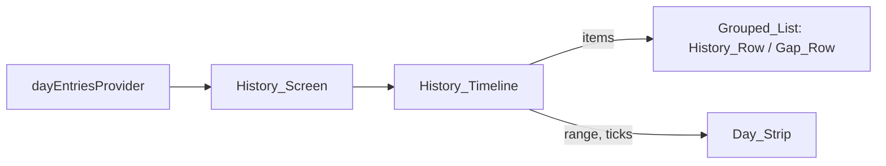

# Design Document: History Timeline

## Overview

The History_Screen keeps its structure (header, Day_Navigator, summary pills, one Grouped_List, swipe hint). Three
things are added or changed: a Day_Strip card between the pills and the list, Gap_Rows between entry rows, and the
order of the two times in a History_Row.

**Key design decisions:**

- **All logic is pure and in one domain file.** The History_Timeline turns the entry list into a list of items (entry or
  gap), and computes the Strip_Range and the tick hours. Widgets only draw what it returns, so the rules are
  unit-tested without a widget tree.
- **The provider is unchanged.** `watchEntriesForDay` already orders by start time descending. The History_Timeline
  sorts again (start descending, id descending) so that its result does not depend on the query.
- **Gaps are derived, never stored.** A gap is the interval between an entry's start and the latest end of all entries
  that start earlier (so an entry that covers a shorter one does not leave a false gap). No schema change, no migration.
- **Time on the axis, not clock hours.** Positions use `DateTime` differences, so an entry across midnight works
  (Requirement 4).
- **Square strip segments**, as in the statistics timeline (Martin's earlier pick).

## Architecture



## Project Structure

```
lib/time_tracking/
├── domain/
│   └── history_timeline.dart           # NEW: items, gaps, Strip_Range, ticks (pure)
└── ui/
    ├── screens/history_screen.dart     # CHANGED: Day_Strip, items instead of entries
    └── widgets/cards/
        ├── history_row.dart            # CHANGED: end above start
        ├── gap_row.dart                # NEW: Gap_Row
        └── day_strip.dart              # NEW: Day_Strip
test/time_tracking/
├── domain/history_timeline_test.dart   # NEW
└── ui/screens/time_screens_test.dart   # CHANGED: order, gap row, strip
```

## Components and Interfaces

### 1. History_Timeline (`lib/time_tracking/domain/history_timeline.dart`)

```dart
/// Shortest interval that gets a Gap_Row.
const Duration historyGapThreshold = Duration(minutes: 5);

sealed class HistoryItem {
  const HistoryItem();
}

final class HistoryEntryItem extends HistoryItem {
  const HistoryEntryItem(this.entry);
  final TimeEntry entry;
}

final class HistoryGapItem extends HistoryItem {
  const HistoryGapItem({required this.from, required this.to});
  final DateTime from; // end of the earlier entry
  final DateTime to; // start of the later entry
  Duration get length => to.difference(from);
}

/// Entries newest first with a [HistoryGapItem] wherever the interval between two
/// neighbours is at least [historyGapThreshold]. Never starts or ends with a gap.
List<HistoryItem> buildHistoryItems(List<TimeEntry> entries);

const Duration dayStripMinSpan = Duration(hours: 6);
const int dayStripMaxTicks = 5;

typedef DayStripRange = ({DateTime start, DateTime end});

/// The interval the Day_Strip covers. [now] is given only for today.
DayStripRange dayStripRange(List<TimeEntry> entries, {DateTime? now});

/// Whole hours inside [range], with the smallest step of 1, 2, 3, 6, 12 or 24 hours that gives at most five.
List<DateTime> dayStripTicks(DayStripRange range);
```

`dayStripRange`: start = the earliest start floored to the hour, end = the later of the latest end and `now` (when
given) ceiled to the hour; when the span is under 6 hours the end moves later until it is 6 hours.

### 2. Day_Strip (`lib/time_tracking/ui/widgets/cards/day_strip.dart`)

```dart
class DayStrip extends StatelessWidget {
  const DayStrip({super.key, required this.entries, required this.isDark, this.now});
  final List<TimeEntry> entries;
  final bool isDark;
  final DateTime? now; // set only when the selected day is today
}
```

A `Padding` + card (`palette.card`, hairline `palette.boardLine`, `Radii.group`) holding a 22 px bar (`palette.tone`
track, square segments in `activityEntryColor`, one hairline of the card colour between neighbours), the Now_Marker
(2 px, `palette.text`) and a row of tick labels in 11 px `palette.textFaint`, tabular figures. One `Semantics` node
with the label `time_historyStripLabel`; the drawing is excluded from semantics.

### 3. Gap_Row (`lib/time_tracking/ui/widgets/cards/gap_row.dart`)

```dart
class GapRow extends StatelessWidget {
  const GapRow({super.key, required this.length});
  final Duration length;
}
```

A row on the `palette.tone` background: a dashed line, the text `time_historyGap(duration)` in 12.5 px weight 600 in
`palette.textDim`, a short dashed line. Same horizontal padding as the History_Row; no `InkWell`.

### 4. History_Row (`.../history_row.dart`)

Only the time column changes: `Text(_formatTime(entry.endTime))` above `Text(_formatTime(entry.startTime))`.

### 5. History_Screen (`.../history_screen.dart`)

`DaySummary` keeps receiving the entries. Between it and the list: `DayStrip(entries, isDark, now: isToday ? clock.now() : null)`.
The `GroupedList` children come from `buildHistoryItems(entries)`: `HistoryEntryItem` → `HistoryRow` (as now),
`HistoryGapItem` → `GapRow`. `isToday` is the existing `_isToday(selectedDay, clock.now())`.

## Data Models

No schema change. The new strings:

| Key | cs | en |
|---|---|---|
| `time_historyGap` | pauza {duration} | gap {duration} |
| `time_historyStripLabel` | Přehled dne od {from} do {to} | Day overview from {from} to {to} |

## Correctness Properties

### Property 1: Gaps lie exactly between neighbours

*For any* list of entries, every HistoryGapItem produced by `buildHistoryItems` SHALL lie between two HistoryEntryItems and SHALL have a length of at least the Gap_Threshold.

**Validates: Requirements 2.1, 2.3, 2.4, 2.5**

### Property 2: Entries are kept and ordered

*For any* list of entries, the HistoryEntryItems of `buildHistoryItems` SHALL contain every entry exactly once, ordered by start descending and id descending.

**Validates: Requirements 1.1, 1.2**

### Property 3: Strip range covers the day

*For any* non-empty list of entries and any `now`, the range of `dayStripRange` SHALL start and end on whole hours, SHALL contain every entry and `now`, and SHALL span at least 6 hours; the ticks SHALL be whole hours inside it and at most five.

**Validates: Requirements 3.4, 3.5, 3.7, 3.8, 4.1**

## Error Handling

| Category | Condition | Behaviour |
|---|---|---|
| Entry with end before start | Corrupt or imported row | Counted as zero length: no segment width, no gap |
| Empty list | Day without entries | `buildHistoryItems` returns an empty list, Day_Strip is not built |
| Unparseable timestamp | Corrupt row | Same as today: `DateTime.parse` throws; the screen's error state is not extended |

## Testing Strategy

- **Unit** (`flutter_test`, `test/time_tracking/domain/history_timeline_test.dart`): ordering and tie-break, gap
  threshold (4, 5, 6 minutes), overlap, midnight, range and ticks, with a seeded random generator for Properties 1–3.
- **Widget** (`test/time_tracking/ui/screens/time_screens_test.dart`): rows are in newest-first order, a Gap_Row shows
  the pause, no Gap_Row for a short interval, the Day_Strip exists for entries and not for an empty day, the existing
  tap/swipe/delete test still passes.
- **Goldens**: regenerate `test/goldens/history_{light,dark}.png` and check them against the mockup
  `.design/history-timeline/` (variant C).
- **Real app**: run the Linux app with a seeded day and look at the screen (skill `sandbox-flutter-linux-run`).
