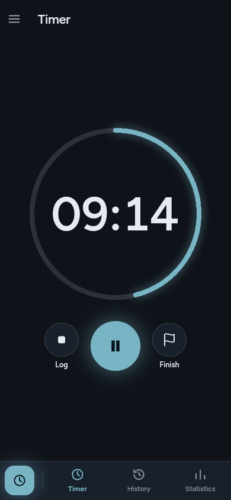
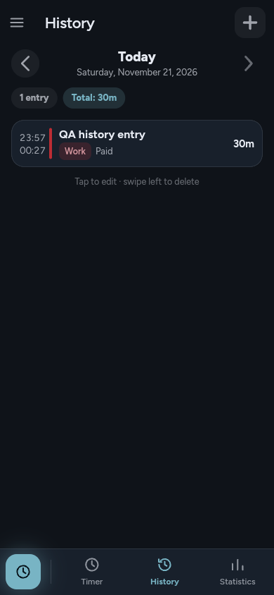
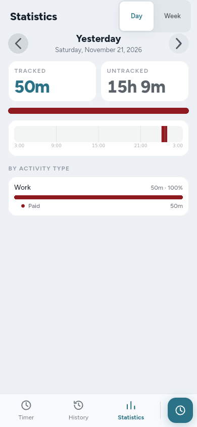
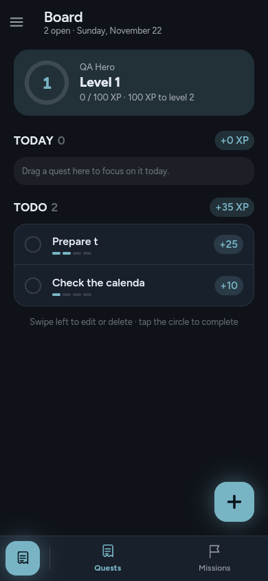
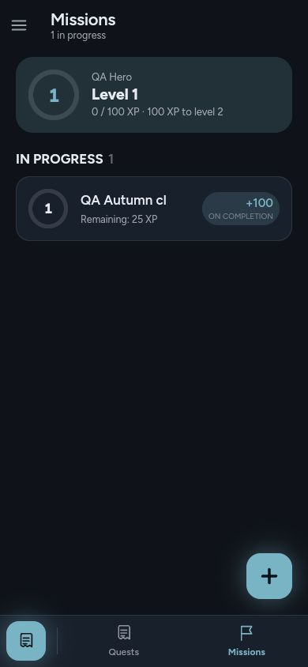
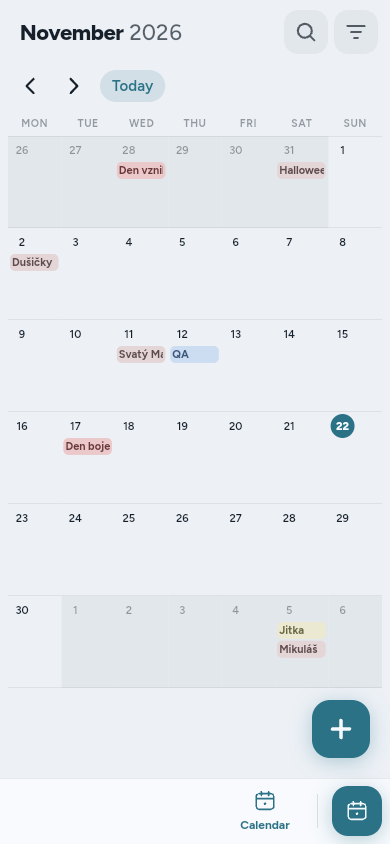
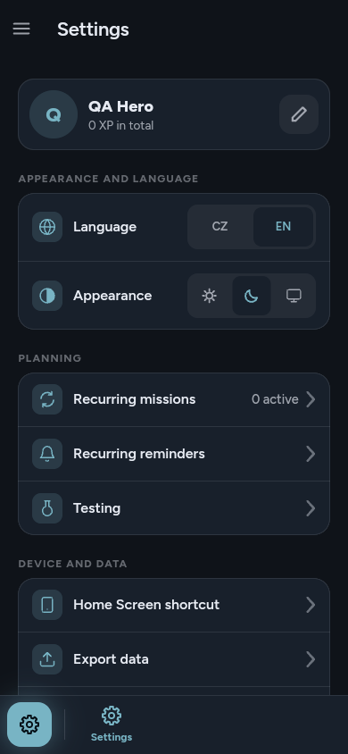
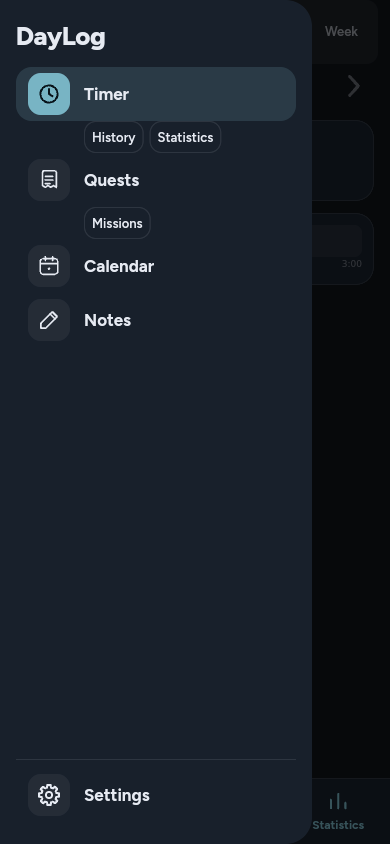

<div align="center">

# DayLog

### One personal app for your day: time, quests, calendar and notes

**A countdown timer that logs your time, quests and missions with XP, a calendar and notes. Everything stays on your phone.**

[Quick Start](#-installation) · [Usage](#-usage) · [Features](./FEATURES.md) · [Documentation](./DOCS.md) · [Changelog](./CHANGELOG.md)

</div>

## 📋 Description

DayLog is the merger of two earlier apps, TimeLog (time tracking) and QuestLog (quests, missions,
calendar, notes), in one Flutter app for iOS. It adds nothing new to either: every page works as it did,
and the data of both apps can be loaded into it.

- **Timer** (the first screen): a countdown that logs what you did, with History and Statistics.
- **Quests and Missions**: one-off tasks and long-term goals that earn XP and levels.
- **Calendar** and **Notes** next to them.
- Dark and light theme, Czech and English. Everything stays on your phone: no server, no account, no network.

Every feature in detail: [FEATURES.md](./FEATURES.md).

## 📸 Screenshots

<a href="screenshots/01-timer.png"></a>&nbsp;&nbsp;<a href="screenshots/02-history.png"></a>&nbsp;&nbsp;<a href="screenshots/03-statistics.png"></a>&nbsp;&nbsp;<a href="screenshots/04-board.png"></a>

<a href="screenshots/05-missions.png"></a>&nbsp;&nbsp;<a href="screenshots/06-calendar.png"></a>&nbsp;&nbsp;<a href="screenshots/07-settings.png"></a>&nbsp;&nbsp;<a href="screenshots/08-drawer.png"></a>

## 🔧 Prerequisites

- [Flutter](https://docs.flutter.dev/get-started/install) 3.47 or newer (Dart 3.13 or newer; see
  `environment.sdk` in `pubspec.yaml`)
- For the iOS build: a Mac with Xcode (iOS 18 or newer on the device)
- For the Linux desktop build, only to try the app: the Flutter Linux toolchain with GTK 3 headers, GStreamer
  development packages (the alarm sound) and a D-Bus session (notifications); see Troubleshooting in
  [DOCS.md](./DOCS.md)

## 🚀 Installation

```bash
git clone <repository-url> daylog
cd daylog
flutter pub get
timeout 500 dart run build_runner build   # generates the Drift and freezed code
```

DayLog has no environment variables. `.env.example` exists only to say so.

> [!NOTE]
> The code generation takes a few minutes. The generated files (`*.g.dart`, `*.freezed.dart`) and the
> localizations in `lib/l10n/` are committed, so a fresh clone builds without it; run it again only after
> changing a Drift table or the timer state.

## 🎮 Usage

```bash
flutter run                         # run on a connected device or simulator
scripts/check.sh                    # flutter analyze + all tests (about 10 min) + directory-size check
scripts/release.sh 1.0.0            # bump the version, update CHANGELOG.md, commit and tag
```

The bottom bar shows the pages of the active module. Tap its module button to switch between Time, Quests,
Calendar, Notes and Settings. Swipe across the same button to return to the previous module. The optional
side drawer offers shortcuts to each module and its pages.

**Moving from TimeLog and QuestLog.** In each old app (QuestLog 1.5.0, TimeLog 1.2.0), open Settings → Data →
Export data and save the file. Then in DayLog open Settings → Device and data → Import data, pick the file, and confirm
what it replaces. Compare the counts with the old app before you stop using it. The steps are in
[DOCS.md](./DOCS.md#moving-from-timelog-and-questlog).

**Home Screen shortcuts.** A link such as `daylog://timer` or `daylog://calendar` opens a page; Settings →
Home Screen shortcut explains how to put it on the Home Screen with the Shortcuts app.

## 📦 Deployment

There is no server and no hosted deployment. DayLog is installed on an iPhone from Xcode, built on a Mac from
this repository. The iOS build, the Live Activity, the alarm and the notifications cannot be exercised from the
Linux development environment, so they are checked on the device by hand.

## 📚 Documentation

For more details see [DOCS.md](./DOCS.md)

## 👤 Author

👤 **Martin Jablečník**

- Website: [www.jablecnik.com](https://www.jablecnik.com)
- Github: [@mjablecnik](https://github.com/mjablecnik)

## ⭐️ Show your support

Give a ⭐️ if this project helped you!

## 📝 License

Copyright © 2026 Martin Jablečník.
This project is licensed under the [GNU General Public License v3.0](./LICENSE).
